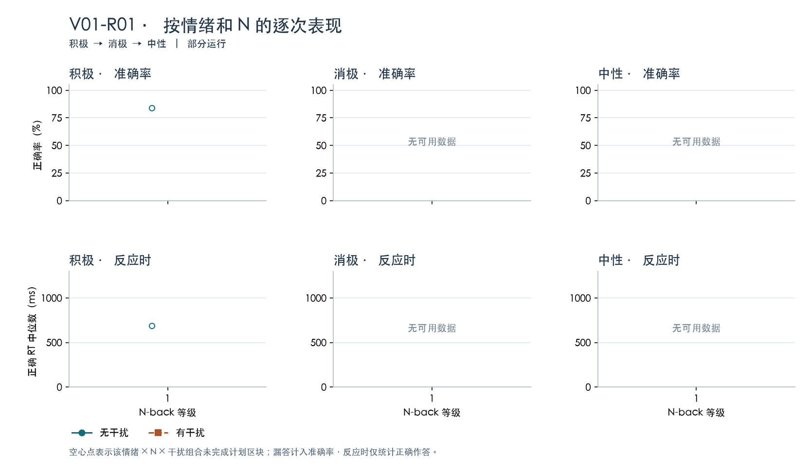

# V01 逐次运行分析

[返回版本汇总](README.md) · [逐次分析索引](../README.md)

每个编号是一次去标识化运行。档案无法确认哪些编号属于同一人。漏答计入正确率分母，RT 中位数仅用正确且有记录的 J/F 作答，校正 d′ 按有效作答计算。有完整区块日志且达到计划区块数的条件才在图中连线。

[V01-R01](#v01-r01)

### V01-R01

[原始数据 ZIP](运行包/V01-R01.zip) · 状态：部分运行 · 计划顺序：积极 → 消极 → 中性

整体正确 **21/25（84.0%）**，漏答 0，正确 RT 中位数 690 ms，最高通过 N（积极／中性／消极）为 —／—／—。

| 情绪 | N | 干扰 | 完成／计划区块 | 正确／计分 | 漏答 | 正确 RT 中位数（ms） | 命中／有效匹配 | 虚报／有效非匹配 | 校正 d′ |
| --- | --- | --- | --- | --- | --- | --- | --- | --- | --- |
| 积极 | 1 | 无干扰 | 1/2 | 21/25（84.0%） | 0 | 690 | 4/8（50.0%） | 0/17（0.0%） | 1.91 |

未达到可配对比较的等级。部分区块保留在上表。

| 试次类型 | 正确／计分 | 正确 RT 中位数（ms） |
| --- | --- | --- |
| 匹配 | 4/8（50.0%） | 530 |
| 诱饵 | 2/2（100.0%） | 746 |
| 其他非匹配·熟悉度不详 | 15/15（100.0%） | 693 |
