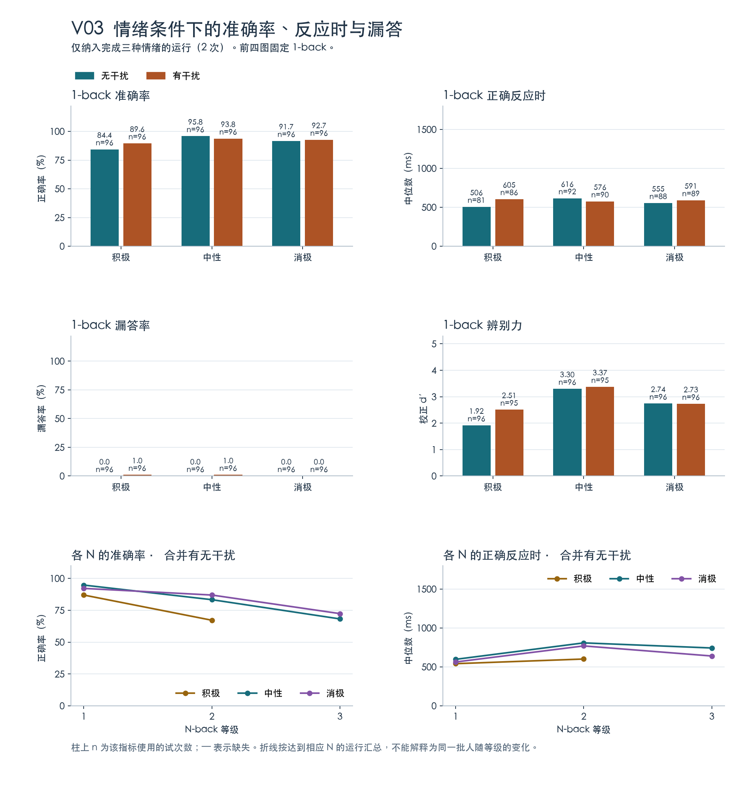

# V03 · 十词与 8／8／8 配额、80% 阶梯

[返回跨版本分析](../跨版本分析.md) · [对应代码](../../代码包/V03.zip) · [设计与版本](../../文档/设计与版本.md) · [反馈与改进](../../文档/反馈与改进.md)

**单次运行单独看：** [打开 V03 的逐次图表和数据](逐次分析.md)。

## 情绪表现图

上四图固定 1-back，分情绪比较有无干扰。下两图按 N 合并有无干扰，较高 N 只汇总实际达到该等级的运行。正确反应时使用中位数，柱上 n 为该指标实际纳入的试次数。

## 运行记录与核对

运行清单共 5 份，完成 2、部分 3、无计分 0。逐试次复核 1769 个计分试次、72 个有区块汇总的区块、17 个有等级判定的有无干扰配对。另有 2 个已写试次但没有区块汇总的区块。

| 运行包 | 状态 | 情绪顺序（计划） | 正确／计分 | 漏答 | 正确 RT 中位数（ms） | 完成区块 | 试次历时和（分） | 最高 N（积极／中性／消极） |
| --- | --- | --- | --- | --- | --- | --- | --- | --- |
| [V03-R01](运行包/V03-R01.zip) | 部分运行 | 积极→消极→中性 | 4/20（20.0%） | 16 | 1381 | 0 | 1.08 | —／—／— |
| [V03-R02](运行包/V03-R02.zip) | 部分运行 | 积极→消极→中性 | 114/168（67.9%） | 25 | 708 | 7 | 4.63 | —／—／— |
| [V03-R03](运行包/V03-R03.zip) | 完成 | 积极→中性→消极 | 639/768（83.2%） | 1 | 723 | 32 | 17.56 | 1／2／2 |
| [V03-R04](运行包/V03-R04.zip) | 部分运行 | 积极→消极→中性 | 40/45（88.9%） | 0 | 450 | 1 | 0.79 | —／—／— |
| [V03-R05](运行包/V03-R05.zip) | 完成 | 中性→消极→积极 | 613/768（79.8%） | 1 | 589 | 32 | 15.59 | 1／2／2 |

试次历时和取日志字段 trial_elapsed_seconds 的加总，含启动词。它只反映记录下来的试次时间，不等于全程用时。最高 N 的 0 表示 1-back 未达升级线。

## 按 N 和试次类别

以下行为汇总只纳入完成三种情绪的运行。每一级或类别按试次汇总，运行贡献量可不同。

| 分组 | 正确／计分 | 漏答 | 正确 RT 中位数（ms） | 正确 RT 均值（ms） | 命中／目标作答 | 虚报／非目标作答 | 校正 d′ |
| --- | --- | --- | --- | --- | --- | --- | --- |
| 1-back | 526/576（91.3%） | 2 | 573 | 599 | 156/191（81.7%） | 13/383（3.4%） | 2.71 |
| 2-back | 456/576（79.2%） | 0 | 746 | 748 | 131/192（68.2%） | 59/384（15.4%） | 1.49 |
| 3-back | 270/384（70.3%） | 0 | 714 | 739 | 78/128（60.9%） | 64/256（25.0%） | 0.95 |

| 分组 | 正确／计分 | 漏答 | 正确 RT 中位数（ms） | 正确 RT 均值（ms） | 命中／目标作答 | 虚报／非目标作答 | 校正 d′ |
| --- | --- | --- | --- | --- | --- | --- | --- |
| 匹配 | 365/512（71.3%） | 1 | 661 | 673 | 365/511（71.4%） | — | — |
| 诱饵 | 401/512（78.3%） | 0 | 723 | 725 | — | 111/512（21.7%） | — |
| 其他非匹配·曾出现 | 108/120（90.0%） | 0 | 725 | 726 | — | 12/120（10.0%） | — |
| 其他非匹配·首次出现 | 378/392（96.4%） | 1 | 613 | 637 | — | 13/391（3.3%） | — |

## 同一 N 的情绪位置和干扰比较

固定 1-back，并分开显示情绪与干扰条件。校正 d′ 只计有效 J/F 作答，漏答单列，正确率仍以所有计分试次为分母。

| 分组 | 正确／计分 | 漏答 | 正确 RT 中位数（ms） | 正确 RT 均值（ms） | 命中／目标作答 | 虚报／非目标作答 | 校正 d′ |
| --- | --- | --- | --- | --- | --- | --- | --- |
| 积极 · 无干扰 | 81/96（84.4%） | 0 | 506 | 566 | 20/32（62.5%） | 3/64（4.7%） | 1.92 |
| 积极 · 有干扰 | 86/96（89.6%） | 1 | 605 | 606 | 25/32（78.1%） | 2/63（3.2%） | 2.51 |
| 中性 · 无干扰 | 92/96（95.8%） | 0 | 616 | 631 | 31/32（96.9%） | 3/64（4.7%） | 3.30 |
| 中性 · 有干扰 | 90/96（93.8%） | 1 | 576 | 605 | 26/31（83.9%） | 0/64（0.0%） | 3.37 |
| 消极 · 无干扰 | 88/96（91.7%） | 0 | 555 | 562 | 25/32（78.1%） | 1/64（1.6%） | 2.74 |
| 消极 · 有干扰 | 89/96（92.7%） | 0 | 591 | 621 | 29/32（90.6%） | 4/64（6.2%） | 2.73 |

| 情绪组出现位置（仅 1-back） | 正确／计分 | 漏答 |
| --- | --- | --- |
| 1 | 174/192（90.6%） | 0 |
| 2 | 184/192（95.8%） | 1 |
| 3 | 168/192（87.5%） | 1 |

差值按同一运行、同一情绪、同一 N 的“有干扰减去无干扰”计算。全等级只用于描述各记录的配对方向，主要对照看各完成运行均具备的 1-back。

| 范围 | 配对数 | 有干扰较高／较低／持平 | 平均差（百分点） | 差中位数（百分点） |
| --- | --- | --- | --- | --- |
| 仅 1-back | 6 | 3／2／1 | 1.39 | 1.04 |
| 全部已完成配对 | 16 | 11／3／2 | 3.65 | 2.08 |

## 词序结构复算

| N | 区块数 | 平均实际词数 | 计分阶段首次出现词／区块 | 有连续六位置至多两种词的区块 | 观察到的最长正确 F 串 | 凭熟悉度的模拟正确题数／24 |
| --- | --- | --- | --- | --- | --- | --- |
| 1 | 24 | 8.0 | 7.0 | 24/24 | 14 | 15.0 |
| 2 | 24 | 8.0 | 6.0 | 23/24 | 10 | 14.0 |
| 3 | 16 | 8.0 | 5.0 | 9/16 | 8 | 13.0 |

结构表使用完成运行的区块，重复窗口包含启动词。模拟策略是“词在本区块出现过按 J，否则按 F”，用于衡量捷径本身可获得的分数。始终按 F 在这些区块固定能答对 16/24。两者都不是对单个被试策略的分类。

## 这版数据支持什么改动

- **配额开始稳定，但新词仍给出强线索。** 72/72 个有汇总的区块满足 8／8／8。两次完成运行中，首次出现的普通非匹配答对 378/392（96.4%），正确 RT 均值 637 ms；已出现的普通非匹配为 108/120（90.0%）、726 ms，诱饵为 401/512（78.3%）、725 ms。结合“凭印象按 J”的口述，问题从类别总数转向如何分布熟悉词和新词。正确率与 RT 的差异无法确定个体使用了哪种策略。
- **重复位置仍有可预测结构。** 在完成运行的 24 个 2-back 区块，23 个至少出现一次连续六位置最多两种词，正确 F 的最长串为 10。这支持在下一版约束局部词汇多样性。单列词序约束后，才有可能区分新增诱饵与词序结构本身的影响。
- **长版的作答量与时长。** 两次完成运行均有 32 个区块、768 个计分试次，记录的试次历时和分别为 17.56 和 15.59 分钟。另外两次未完成的运行，已记录的 188 题中有 41 题漏答。结合长版耗时、难度升高的反馈，下一版将每个条件由两个区块减为一个。
- **情绪出现位置会影响如何解释正确率。** 两次完成运行的 1-back 合计从第一组 174/192 升至第二组 184/192，第三组为 168/192。该数据支持检查练习、疲劳和位置因素；只凭位置汇总无法判定第二组上升来自熟悉任务还是情绪。
