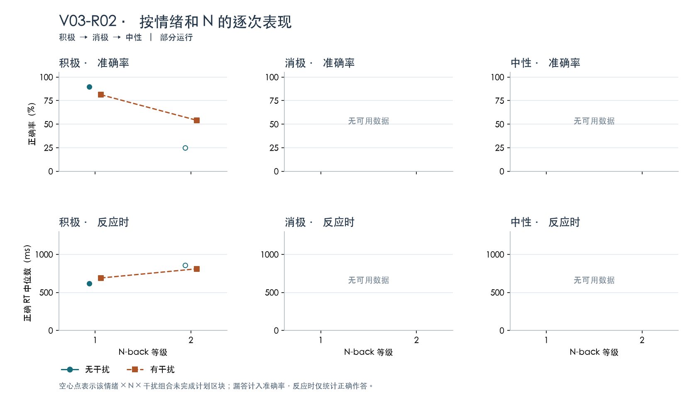
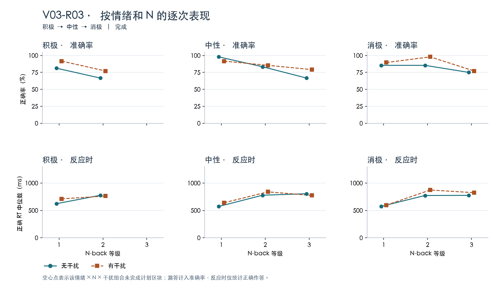
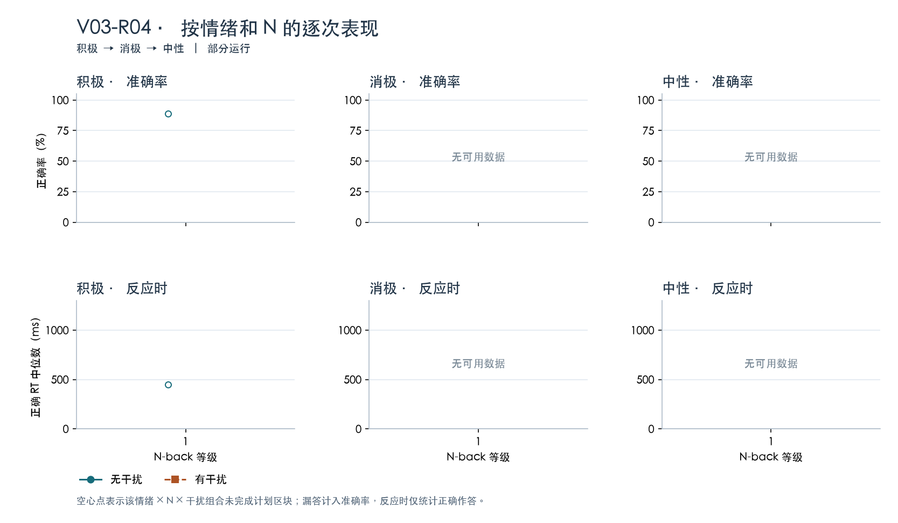
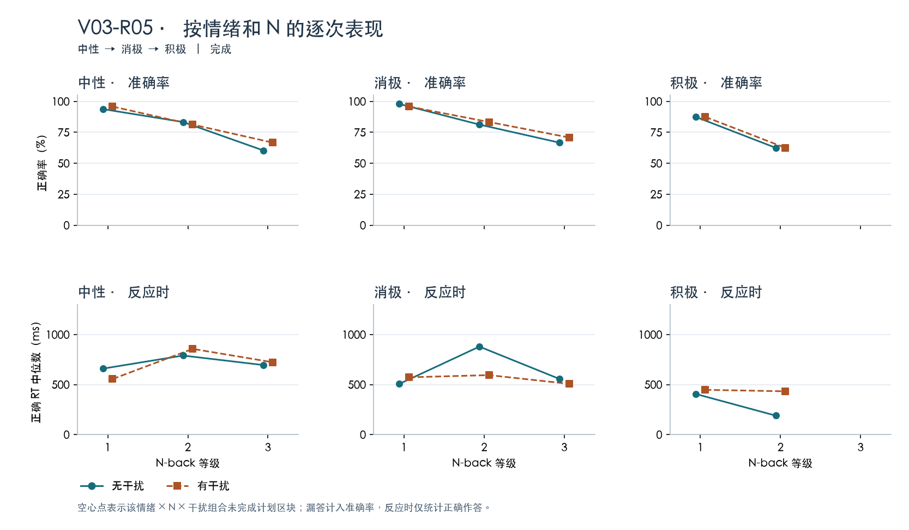

# V03 逐次运行分析

[返回版本汇总](README.md) · [逐次分析索引](../README.md)

每个编号是一次去标识化运行。档案无法确认哪些编号属于同一人。漏答计入正确率分母，RT 中位数仅用正确且有记录的 J/F 作答，校正 d′ 按有效作答计算。有完整区块日志且达到计划区块数的条件才在图中连线。

[V03-R01](#v03-r01) · [V03-R02](#v03-r02) · [V03-R03](#v03-r03) · [V03-R04](#v03-r04) · [V03-R05](#v03-r05)

### V03-R01

[原始数据 ZIP](运行包/V03-R01.zip) · 状态：部分运行 · 计划顺序：积极 → 消极 → 中性

整体正确 **4/20（20.0%）**，漏答 16，正确 RT 中位数 1381 ms，最高通过 N（积极／中性／消极）为 —／—／—。

| 情绪 | N | 干扰 | 完成／计划区块 | 正确／计分 | 漏答 | 正确 RT 中位数（ms） | 命中／有效匹配 | 虚报／有效非匹配 | 校正 d′ |
| --- | --- | --- | --- | --- | --- | --- | --- | --- | --- |
| 积极 | 1 | 无干扰 | 0/2 | 4/20（20.0%） | 16 | 1381 | 3/3（100.0%） | 0/1（0.0%） | 1.82 |

漏答比例最高的组合是 **积极 · 1-back · 无干扰**（16/20（80.0%））。

未达到可配对比较的等级。部分区块保留在上表。

| 试次类型 | 正确／计分 | 正确 RT 中位数（ms） |
| --- | --- | --- |
| 匹配 | 3/6（50.0%） | 1391 |
| 诱饵 | 0/7（0.0%） | — |
| 其他非匹配·首次出现 | 1/7（14.3%） | 927 |

### V03-R02

[原始数据 ZIP](运行包/V03-R02.zip) · 状态：部分运行 · 计划顺序：积极 → 消极 → 中性

整体正确 **114/168（67.9%）**，漏答 25，正确 RT 中位数 708 ms，最高通过 N（积极／中性／消极）为 —／—／—。

| 情绪 | N | 干扰 | 完成／计划区块 | 正确／计分 | 漏答 | 正确 RT 中位数（ms） | 命中／有效匹配 | 虚报／有效非匹配 | 校正 d′ |
| --- | --- | --- | --- | --- | --- | --- | --- | --- | --- |
| 积极 | 1 | 无干扰 | 2/2 | 43/48（89.6%） | 0 | 615 | 16/16（100.0%） | 5/32（15.6%） | 2.86 |
| 积极 | 1 | 有干扰 | 2/2 | 39/48（81.2%） | 3 | 690 | 14/16（87.5%） | 4/29（13.8%） | 2.09 |
| 积极 | 2 | 无干扰 | 1/2 | 6/24（25.0%） | 18 | 857 | 3/3（100.0%） | 0/3（0.0%） | 2.30 |
| 积极 | 2 | 有干扰 | 2/2 | 26/48（54.2%） | 4 | 810 | 6/14（42.9%） | 10/30（33.3%） | 0.25 |

漏答比例最高的组合是 **积极 · 2-back · 无干扰**（18/24（75.0%））。

有干扰准确率较高／较低／持平为 **0／1／0**。下表均为同一情绪、同一 N 内的「有干扰减无干扰」。

| 情绪 | N | 准确率差（百分点） | 正确 RT 中位数差（ms） | 校正 d′ 差 | 漏答数差 |
| --- | --- | --- | --- | --- | --- |
| 积极 | 1 | -8.3 | +74 | -0.77 | 3 |

| 试次类型 | 正确／计分 | 正确 RT 中位数（ms） |
| --- | --- | --- |
| 匹配 | 39/56（69.6%） | 655 |
| 诱饵 | 34/56（60.7%） | 792 |
| 其他非匹配·曾出现 | 7/10（70.0%） | 773 |
| 其他非匹配·首次出现 | 34/46（73.9%） | 650 |

### V03-R03

[原始数据 ZIP](运行包/V03-R03.zip) · 状态：完成 · 计划顺序：积极 → 中性 → 消极

整体正确 **639/768（83.2%）**，漏答 1，正确 RT 中位数 723 ms，最高通过 N（积极／中性／消极）为 1／2／2。

| 情绪 | N | 干扰 | 完成／计划区块 | 正确／计分 | 漏答 | 正确 RT 中位数（ms） | 命中／有效匹配 | 虚报／有效非匹配 | 校正 d′ |
| --- | --- | --- | --- | --- | --- | --- | --- | --- | --- |
| 积极 | 1 | 无干扰 | 2/2 | 39/48（81.2%） | 0 | 622 | 10/16（62.5%） | 3/32（9.4%） | 1.55 |
| 积极 | 1 | 有干扰 | 2/2 | 44/48（91.7%） | 0 | 711 | 13/16（81.2%） | 1/32（3.1%） | 2.51 |
| 积极 | 2 | 无干扰 | 2/2 | 32/48（66.7%） | 0 | 776 | 11/16（68.8%） | 11/32（34.4%） | 0.85 |
| 积极 | 2 | 有干扰 | 2/2 | 37/48（77.1%） | 0 | 763 | 11/16（68.8%） | 6/32（18.8%） | 1.31 |
| 中性 | 1 | 无干扰 | 2/2 | 47/48（97.9%） | 0 | 572 | 16/16（100.0%） | 1/32（3.1%） | 3.58 |
| 中性 | 1 | 有干扰 | 2/2 | 44/48（91.7%） | 1 | 639 | 12/15（80.0%） | 0/32（0.0%） | 2.94 |
| 中性 | 2 | 无干扰 | 2/2 | 40/48（83.3%） | 0 | 778 | 14/16（87.5%） | 6/32（18.8%） | 1.90 |
| 中性 | 2 | 有干扰 | 2/2 | 41/48（85.4%） | 0 | 839 | 13/16（81.2%） | 4/32（12.5%） | 1.92 |
| 中性 | 3 | 无干扰 | 2/2 | 32/48（66.7%） | 0 | 805 | 10/16（62.5%） | 10/32（31.2%） | 0.77 |
| 中性 | 3 | 有干扰 | 2/2 | 38/48（79.2%） | 0 | 773 | 11/16（68.8%） | 5/32（15.6%） | 1.43 |
| 消极 | 1 | 无干扰 | 2/2 | 41/48（85.4%） | 0 | 573 | 10/16（62.5%） | 1/32（3.1%） | 1.99 |
| 消极 | 1 | 有干扰 | 2/2 | 43/48（89.6%） | 0 | 596 | 14/16（87.5%） | 3/32（9.4%） | 2.30 |
| 消极 | 2 | 无干扰 | 2/2 | 41/48（85.4%） | 0 | 773 | 13/16（81.2%） | 4/32（12.5%） | 1.92 |
| 消极 | 2 | 有干扰 | 2/2 | 47/48（97.9%） | 0 | 873 | 15/16（93.8%） | 0/32（0.0%） | 3.52 |
| 消极 | 3 | 无干扰 | 2/2 | 36/48（75.0%） | 0 | 775 | 12/16（75.0%） | 8/32（25.0%） | 1.28 |
| 消极 | 3 | 有干扰 | 2/2 | 37/48（77.1%） | 0 | 824 | 12/16（75.0%） | 7/32（21.9%） | 1.38 |

漏答比例最高的组合是 **中性 · 1-back · 有干扰**（1/48（2.1%））。

**固定 1-back 的实际组序**：积极 83/96（86.5%） → 中性 91/96（94.8%） → 消极 84/96（87.5%）。

有干扰准确率较高／较低／持平为 **7／1／0**。下表均为同一情绪、同一 N 内的「有干扰减无干扰」。

| 情绪 | N | 准确率差（百分点） | 正确 RT 中位数差（ms） | 校正 d′ 差 | 漏答数差 |
| --- | --- | --- | --- | --- | --- |
| 积极 | 1 | +10.4 | +89 | +0.96 | 0 |
| 积极 | 2 | +10.4 | -14 | +0.46 | 0 |
| 中性 | 1 | -6.2 | +67 | -0.64 | 1 |
| 中性 | 2 | +2.1 | +61 | +0.02 | 0 |
| 中性 | 3 | +12.5 | -31 | +0.65 | 0 |
| 消极 | 1 | +4.2 | +23 | +0.31 | 0 |
| 消极 | 2 | +12.5 | +100 | +1.60 | 0 |
| 消极 | 3 | +2.1 | +49 | +0.10 | 0 |

| 试次类型 | 正确／计分 | 正确 RT 中位数（ms） |
| --- | --- | --- |
| 匹配 | 197/256（77.0%） | 699 |
| 诱饵 | 199/256（77.7%） | 773 |
| 其他非匹配·曾出现 | 54/60（90.0%） | 842 |
| 其他非匹配·首次出现 | 189/196（96.4%） | 673 |

### V03-R04

[原始数据 ZIP](运行包/V03-R04.zip) · 状态：部分运行 · 计划顺序：积极 → 消极 → 中性

整体正确 **40/45（88.9%）**，漏答 0，正确 RT 中位数 450 ms，最高通过 N（积极／中性／消极）为 —／—／—。

| 情绪 | N | 干扰 | 完成／计划区块 | 正确／计分 | 漏答 | 正确 RT 中位数（ms） | 命中／有效匹配 | 虚报／有效非匹配 | 校正 d′ |
| --- | --- | --- | --- | --- | --- | --- | --- | --- | --- |
| 积极 | 1 | 无干扰 | 1/2 | 40/45（88.9%） | 0 | 450 | 10/13（76.9%） | 2/32（6.2%） | 2.11 |

未达到可配对比较的等级。部分区块保留在上表。

| 试次类型 | 正确／计分 | 正确 RT 中位数（ms） |
| --- | --- | --- |
| 匹配 | 10/13（76.9%） | 499 |
| 诱饵 | 15/16（93.8%） | 440 |
| 其他非匹配·曾出现 | 2/2（100.0%） | 558 |
| 其他非匹配·首次出现 | 13/14（92.9%） | 423 |

### V03-R05

[原始数据 ZIP](运行包/V03-R05.zip) · 状态：完成 · 计划顺序：中性 → 消极 → 积极

整体正确 **613/768（79.8%）**，漏答 1，正确 RT 中位数 589 ms，最高通过 N（积极／中性／消极）为 1／2／2。

| 情绪 | N | 干扰 | 完成／计划区块 | 正确／计分 | 漏答 | 正确 RT 中位数（ms） | 命中／有效匹配 | 虚报／有效非匹配 | 校正 d′ |
| --- | --- | --- | --- | --- | --- | --- | --- | --- | --- |
| 中性 | 1 | 无干扰 | 2/2 | 45/48（93.8%） | 0 | 659 | 15/16（93.8%） | 2/32（6.2%） | 2.79 |
| 中性 | 1 | 有干扰 | 2/2 | 46/48（95.8%） | 0 | 555 | 14/16（87.5%） | 0/32（0.0%） | 3.22 |
| 中性 | 2 | 无干扰 | 2/2 | 40/48（83.3%） | 0 | 790 | 13/16（81.2%） | 5/32（15.6%） | 1.79 |
| 中性 | 2 | 有干扰 | 2/2 | 39/48（81.2%） | 0 | 856 | 10/16（62.5%） | 3/32（9.4%） | 1.55 |
| 中性 | 3 | 无干扰 | 2/2 | 29/48（60.4%） | 0 | 695 | 8/16（50.0%） | 11/32（34.4%） | 0.39 |
| 中性 | 3 | 有干扰 | 2/2 | 32/48（66.7%） | 0 | 723 | 9/16（56.2%） | 9/32（28.1%） | 0.71 |
| 消极 | 1 | 无干扰 | 2/2 | 47/48（97.9%） | 0 | 506 | 15/16（93.8%） | 0/32（0.0%） | 3.52 |
| 消极 | 1 | 有干扰 | 2/2 | 46/48（95.8%） | 0 | 572 | 15/16（93.8%） | 1/32（3.1%） | 3.04 |
| 消极 | 2 | 无干扰 | 2/2 | 39/48（81.2%） | 0 | 879 | 10/16（62.5%） | 3/32（9.4%） | 1.55 |
| 消极 | 2 | 有干扰 | 2/2 | 40/48（83.3%） | 0 | 594 | 10/16（62.5%） | 2/32（6.2%） | 1.73 |
| 消极 | 3 | 无干扰 | 2/2 | 32/48（66.7%） | 0 | 556 | 8/16（50.0%） | 8/32（25.0%） | 0.65 |
| 消极 | 3 | 有干扰 | 2/2 | 34/48（70.8%） | 0 | 507 | 8/16（50.0%） | 6/32（18.8%） | 0.85 |
| 积极 | 1 | 无干扰 | 2/2 | 42/48（87.5%） | 0 | 406 | 10/16（62.5%） | 0/32（0.0%） | 2.47 |
| 积极 | 1 | 有干扰 | 2/2 | 42/48（87.5%） | 1 | 447 | 12/16（75.0%） | 1/31（3.2%） | 2.30 |
| 积极 | 2 | 无干扰 | 2/2 | 30/48（62.5%） | 0 | 189 | 6/16（37.5%） | 8/32（25.0%） | 0.35 |
| 积极 | 2 | 有干扰 | 2/2 | 30/48（62.5%） | 0 | 432 | 5/16（31.2%） | 7/32（21.9%） | 0.29 |

漏答比例最高的组合是 **积极 · 1-back · 有干扰**（1/48（2.1%））。

**固定 1-back 的实际组序**：中性 91/96（94.8%） → 消极 93/96（96.9%） → 积极 84/96（87.5%）。

有干扰准确率较高／较低／持平为 **4／2／2**。下表均为同一情绪、同一 N 内的「有干扰减无干扰」。

| 情绪 | N | 准确率差（百分点） | 正确 RT 中位数差（ms） | 校正 d′ 差 | 漏答数差 |
| --- | --- | --- | --- | --- | --- |
| 中性 | 1 | +2.1 | -104 | +0.43 | 0 |
| 中性 | 2 | -2.1 | +67 | -0.24 | 0 |
| 中性 | 3 | +6.2 | +28 | +0.32 | 0 |
| 消极 | 1 | -2.1 | +66 | -0.48 | 0 |
| 消极 | 2 | +2.1 | -285 | +0.19 | 0 |
| 消极 | 3 | +4.2 | -49 | +0.20 | 0 |
| 积极 | 1 | +0.0 | +41 | -0.16 | 1 |
| 积极 | 2 | +0.0 | +243 | -0.06 | 0 |

| 试次类型 | 正确／计分 | 正确 RT 中位数（ms） |
| --- | --- | --- |
| 匹配 | 168/256（65.6%） | 589 |
| 诱饵 | 202/256（78.9%） | 642 |
| 其他非匹配·曾出现 | 54/60（90.0%） | 593 |
| 其他非匹配·首次出现 | 189/196（96.4%） | 547 |
