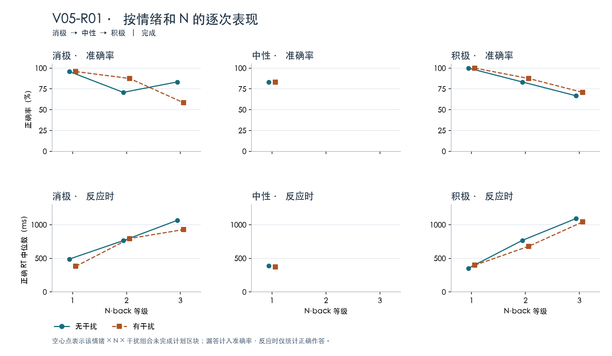
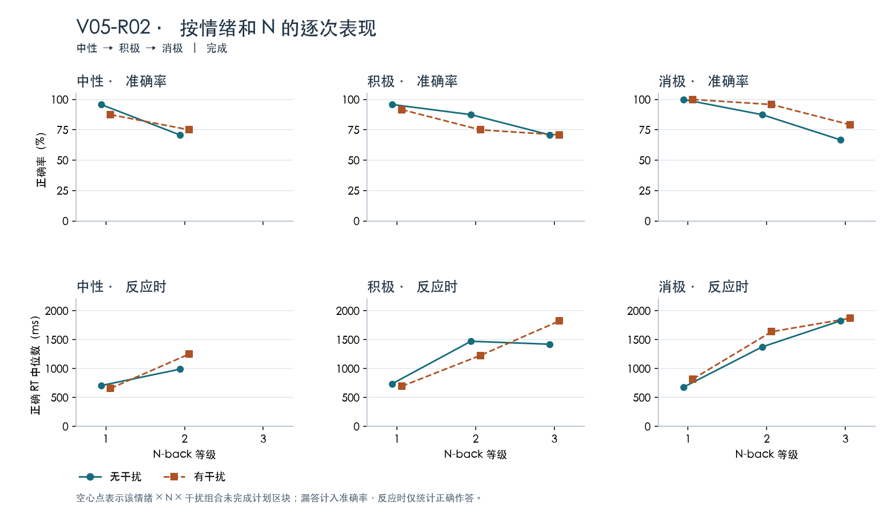
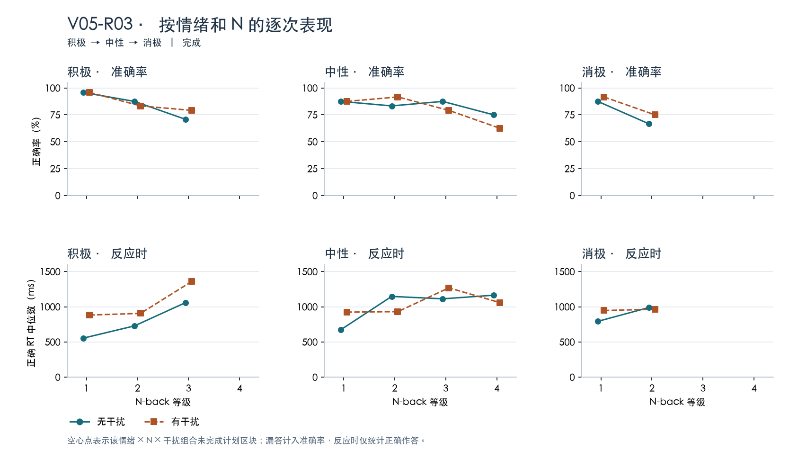
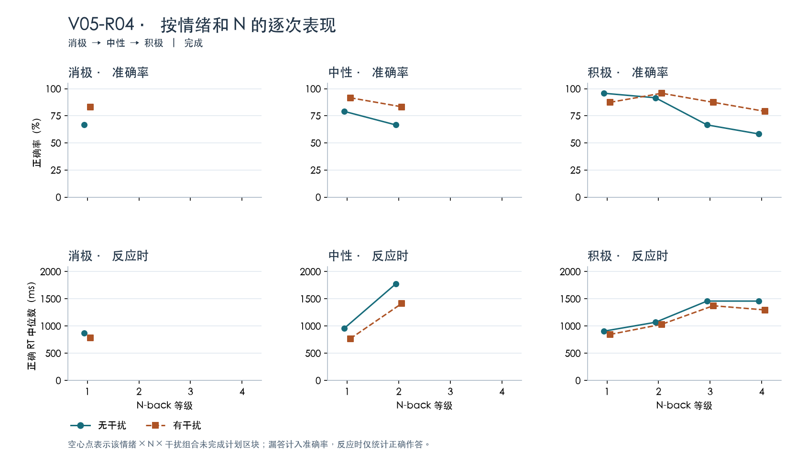
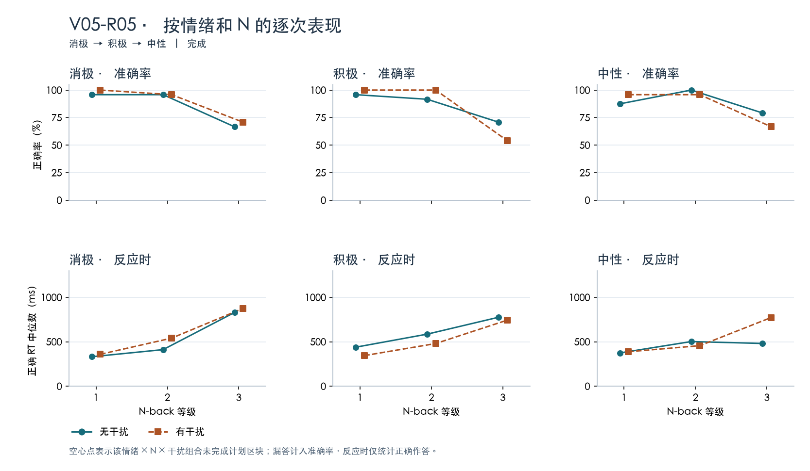

# V05 逐次运行分析

[返回版本汇总](README.md) · [逐次分析索引](../README.md)

每个编号是一次去标识化运行。档案无法确认哪些编号属于同一人。漏答计入正确率分母，RT 中位数仅用正确且有记录的 J/F 作答，校正 d′ 按有效作答计算。有完整区块日志且达到计划区块数的条件才在图中连线。

[V05-R01](#v05-r01) · [V05-R02](#v05-r02) · [V05-R03](#v05-r03) · [V05-R04](#v05-r04) · [V05-R05](#v05-r05)

### V05-R01

[原始数据 ZIP](运行包/V05-R01.zip) · 状态：完成 · 计划顺序：消极 → 中性 → 积极

整体正确 **280/336（83.3%）**，漏答 0，正确 RT 中位数 624 ms，最高通过 N（积极／中性／消极）为 2／0／2。

| 情绪 | N | 干扰 | 完成／计划区块 | 正确／计分 | 漏答 | 正确 RT 中位数（ms） | 命中／有效匹配 | 虚报／有效非匹配 | 校正 d′ |
| --- | --- | --- | --- | --- | --- | --- | --- | --- | --- |
| 消极 | 1 | 无干扰 | 1/1 | 23/24（95.8%） | 0 | 488 | 8/8（100.0%） | 1/16（6.2%） | 2.94 |
| 消极 | 1 | 有干扰 | 1/1 | 23/24（95.8%） | 0 | 380 | 7/8（87.5%） | 0/16（0.0%） | 2.86 |
| 消极 | 2 | 无干扰 | 1/1 | 17/24（70.8%） | 0 | 763 | 5/8（62.5%） | 4/16（25.0%） | 0.91 |
| 消极 | 2 | 有干扰 | 1/1 | 21/24（87.5%） | 0 | 795 | 6/8（75.0%） | 1/16（6.2%） | 1.94 |
| 消极 | 3 | 无干扰 | 1/1 | 20/24（83.3%） | 0 | 1065 | 6/8（75.0%） | 2/16（12.5%） | 1.64 |
| 消极 | 3 | 有干扰 | 1/1 | 14/24（58.3%） | 0 | 928 | 4/8（50.0%） | 6/16（37.5%） | 0.30 |
| 中性 | 1 | 无干扰 | 1/1 | 20/24（83.3%） | 0 | 390 | 5/8（62.5%） | 1/16（6.2%） | 1.63 |
| 中性 | 1 | 有干扰 | 1/1 | 20/24（83.3%） | 0 | 374 | 6/8（75.0%） | 2/16（12.5%） | 1.64 |
| 积极 | 1 | 无干扰 | 1/1 | 24/24（100.0%） | 0 | 351 | 8/8（100.0%） | 0/16（0.0%） | 3.48 |
| 积极 | 1 | 有干扰 | 1/1 | 24/24（100.0%） | 0 | 397 | 8/8（100.0%） | 0/16（0.0%） | 3.48 |
| 积极 | 2 | 无干扰 | 1/1 | 20/24（83.3%） | 0 | 766 | 6/8（75.0%） | 2/16（12.5%） | 1.64 |
| 积极 | 2 | 有干扰 | 1/1 | 21/24（87.5%） | 0 | 679 | 7/8（87.5%） | 2/16（12.5%） | 2.02 |
| 积极 | 3 | 无干扰 | 1/1 | 16/24（66.7%） | 0 | 1093 | 6/8（75.0%） | 6/16（37.5%） | 0.89 |
| 积极 | 3 | 有干扰 | 1/1 | 17/24（70.8%） | 0 | 1042 | 5/8（62.5%） | 4/16（25.0%） | 0.91 |

**固定 1-back 的实际组序**：消极 46/48（95.8%） → 中性 40/48（83.3%） → 积极 48/48（100.0%）。

有干扰准确率较高／较低／持平为 **3／1／3**。下表均为同一情绪、同一 N 内的「有干扰减无干扰」。

| 情绪 | N | 准确率差（百分点） | 正确 RT 中位数差（ms） | 校正 d′ 差 | 漏答数差 |
| --- | --- | --- | --- | --- | --- |
| 消极 | 1 | +0.0 | -108 | -0.09 | 0 |
| 消极 | 2 | +16.7 | +32 | +1.03 | 0 |
| 消极 | 3 | -25.0 | -137 | -1.34 | 0 |
| 中性 | 1 | +0.0 | -16 | +0.00 | 0 |
| 积极 | 1 | +0.0 | +46 | +0.00 | 0 |
| 积极 | 2 | +4.2 | -88 | +0.38 | 0 |
| 积极 | 3 | +4.2 | -51 | +0.02 | 0 |

| 试次类型 | 正确／计分 | 正确 RT 中位数（ms） |
| --- | --- | --- |
| 匹配 | 87/112（77.7%） | 671 |
| 诱饵 | 84/112（75.0%） | 624 |
| 其他非匹配·曾出现 | 43/46（93.5%） | 739 |
| 其他非匹配·首次出现 | 66/66（100.0%） | 440 |

### V05-R02

[原始数据 ZIP](运行包/V05-R02.zip) · 状态：完成 · 计划顺序：中性 → 积极 → 消极

整体正确 **324/384（84.4%）**，漏答 16，正确 RT 中位数 1026 ms，最高通过 N（积极／中性／消极）为 2／1／2。

| 情绪 | N | 干扰 | 完成／计划区块 | 正确／计分 | 漏答 | 正确 RT 中位数（ms） | 命中／有效匹配 | 虚报／有效非匹配 | 校正 d′ |
| --- | --- | --- | --- | --- | --- | --- | --- | --- | --- |
| 中性 | 1 | 无干扰 | 1/1 | 23/24（95.8%） | 0 | 706 | 8/8（100.0%） | 1/16（6.2%） | 2.94 |
| 中性 | 1 | 有干扰 | 1/1 | 21/24（87.5%） | 1 | 658 | 7/7（100.0%） | 2/16（12.5%） | 2.58 |
| 中性 | 2 | 无干扰 | 1/1 | 17/24（70.8%） | 1 | 989 | 5/8（62.5%） | 3/15（20.0%） | 1.06 |
| 中性 | 2 | 有干扰 | 1/1 | 18/24（75.0%） | 0 | 1252 | 4/8（50.0%） | 2/16（12.5%） | 1.05 |
| 积极 | 1 | 无干扰 | 1/1 | 23/24（95.8%） | 0 | 738 | 7/8（87.5%） | 0/16（0.0%） | 2.86 |
| 积极 | 1 | 有干扰 | 1/1 | 22/24（91.7%） | 0 | 693 | 8/8（100.0%） | 2/16（12.5%） | 2.64 |
| 积极 | 2 | 无干扰 | 1/1 | 21/24（87.5%） | 0 | 1472 | 6/8（75.0%） | 1/16（6.2%） | 1.94 |
| 积极 | 2 | 有干扰 | 1/1 | 18/24（75.0%） | 2 | 1227 | 4/7（57.1%） | 1/15（6.7%） | 1.48 |
| 积极 | 3 | 无干扰 | 1/1 | 17/24（70.8%） | 3 | 1421 | 4/7（57.1%） | 1/14（7.1%） | 1.44 |
| 积极 | 3 | 有干扰 | 1/1 | 17/24（70.8%） | 3 | 1822 | 5/7（71.4%） | 2/14（14.3%） | 1.46 |
| 消极 | 1 | 无干扰 | 1/1 | 24/24（100.0%） | 0 | 677 | 8/8（100.0%） | 0/16（0.0%） | 3.48 |
| 消极 | 1 | 有干扰 | 1/1 | 24/24（100.0%） | 0 | 818 | 8/8（100.0%） | 0/16（0.0%） | 3.48 |
| 消极 | 2 | 无干扰 | 1/1 | 21/24（87.5%） | 0 | 1374 | 5/8（62.5%） | 0/16（0.0%） | 2.17 |
| 消极 | 2 | 有干扰 | 1/1 | 23/24（95.8%） | 0 | 1638 | 7/8（87.5%） | 0/16（0.0%） | 2.86 |
| 消极 | 3 | 无干扰 | 1/1 | 16/24（66.7%） | 5 | 1828 | 5/7（71.4%） | 1/12（8.3%） | 1.69 |
| 消极 | 3 | 有干扰 | 1/1 | 19/24（79.2%） | 1 | 1871 | 5/7（71.4%） | 2/16（12.5%） | 1.54 |

漏答比例最高的组合是 **消极 · 3-back · 无干扰**（5/24（20.8%））。

**固定 1-back 的实际组序**：中性 44/48（91.7%） → 积极 45/48（93.8%） → 消极 48/48（100.0%）。

有干扰准确率较高／较低／持平为 **3／3／2**。下表均为同一情绪、同一 N 内的「有干扰减无干扰」。

| 情绪 | N | 准确率差（百分点） | 正确 RT 中位数差（ms） | 校正 d′ 差 | 漏答数差 |
| --- | --- | --- | --- | --- | --- |
| 中性 | 1 | -8.3 | -48 | -0.36 | 1 |
| 中性 | 2 | +4.2 | +262 | -0.01 | -1 |
| 积极 | 1 | -4.2 | -45 | -0.21 | 0 |
| 积极 | 2 | -12.5 | -245 | -0.47 | 2 |
| 积极 | 3 | +0.0 | +401 | +0.02 | 0 |
| 消极 | 1 | +0.0 | +142 | +0.00 | 0 |
| 消极 | 2 | +8.3 | +263 | +0.69 | 0 |
| 消极 | 3 | +12.5 | +43 | -0.15 | -4 |

| 试次类型 | 正确／计分 | 正确 RT 中位数（ms） |
| --- | --- | --- |
| 匹配 | 96/128（75.0%） | 812 |
| 诱饵 | 111/128（86.7%） | 1290 |
| 其他非匹配·曾出现 | 50/56（89.3%） | 1385 |
| 其他非匹配·首次出现 | 67/72（93.1%） | 829 |

### V05-R03

[原始数据 ZIP](运行包/V05-R03.zip) · 状态：完成 · 计划顺序：积极 → 中性 → 消极

整体正确 **357/432（82.6%）**，漏答 0，正确 RT 中位数 936 ms，最高通过 N（积极／中性／消极）为 2／3／1。

| 情绪 | N | 干扰 | 完成／计划区块 | 正确／计分 | 漏答 | 正确 RT 中位数（ms） | 命中／有效匹配 | 虚报／有效非匹配 | 校正 d′ |
| --- | --- | --- | --- | --- | --- | --- | --- | --- | --- |
| 积极 | 1 | 无干扰 | 1/1 | 23/24（95.8%） | 0 | 555 | 7/8（87.5%） | 0/16（0.0%） | 2.86 |
| 积极 | 1 | 有干扰 | 1/1 | 23/24（95.8%） | 0 | 882 | 7/8（87.5%） | 0/16（0.0%） | 2.86 |
| 积极 | 2 | 无干扰 | 1/1 | 21/24（87.5%） | 0 | 728 | 6/8（75.0%） | 1/16（6.2%） | 1.94 |
| 积极 | 2 | 有干扰 | 1/1 | 20/24（83.3%） | 0 | 907 | 4/8（50.0%） | 0/16（0.0%） | 1.89 |
| 积极 | 3 | 无干扰 | 1/1 | 17/24（70.8%） | 0 | 1059 | 5/8（62.5%） | 4/16（25.0%） | 0.91 |
| 积极 | 3 | 有干扰 | 1/1 | 19/24（79.2%） | 0 | 1359 | 6/8（75.0%） | 3/16（18.8%） | 1.41 |
| 中性 | 1 | 无干扰 | 1/1 | 21/24（87.5%） | 0 | 672 | 6/8（75.0%） | 1/16（6.2%） | 1.94 |
| 中性 | 1 | 有干扰 | 1/1 | 21/24（87.5%） | 0 | 925 | 7/8（87.5%） | 2/16（12.5%） | 2.02 |
| 中性 | 2 | 无干扰 | 1/1 | 20/24（83.3%） | 0 | 1147 | 6/8（75.0%） | 2/16（12.5%） | 1.64 |
| 中性 | 2 | 有干扰 | 1/1 | 22/24（91.7%） | 0 | 931 | 8/8（100.0%） | 2/16（12.5%） | 2.64 |
| 中性 | 3 | 无干扰 | 1/1 | 21/24（87.5%） | 0 | 1113 | 6/8（75.0%） | 1/16（6.2%） | 1.94 |
| 中性 | 3 | 有干扰 | 1/1 | 19/24（79.2%） | 0 | 1269 | 6/8（75.0%） | 3/16（18.8%） | 1.41 |
| 中性 | 4 | 无干扰 | 1/1 | 18/24（75.0%） | 0 | 1165 | 7/8（87.5%） | 5/16（31.2%） | 1.43 |
| 中性 | 4 | 有干扰 | 1/1 | 15/24（62.5%） | 0 | 1059 | 3/8（37.5%） | 4/16（25.0%） | 0.35 |
| 消极 | 1 | 无干扰 | 1/1 | 21/24（87.5%） | 0 | 793 | 6/8（75.0%） | 1/16（6.2%） | 1.94 |
| 消极 | 1 | 有干扰 | 1/1 | 22/24（91.7%） | 0 | 948 | 6/8（75.0%） | 0/16（0.0%） | 2.48 |
| 消极 | 2 | 无干扰 | 1/1 | 16/24（66.7%） | 0 | 989 | 6/8（75.0%） | 6/16（37.5%） | 0.89 |
| 消极 | 2 | 有干扰 | 1/1 | 18/24（75.0%） | 0 | 964 | 6/8（75.0%） | 4/16（25.0%） | 1.22 |

**固定 1-back 的实际组序**：积极 46/48（95.8%） → 中性 42/48（87.5%） → 消极 43/48（89.6%）。

有干扰准确率较高／较低／持平为 **4／3／2**。下表均为同一情绪、同一 N 内的「有干扰减无干扰」。

| 情绪 | N | 准确率差（百分点） | 正确 RT 中位数差（ms） | 校正 d′ 差 | 漏答数差 |
| --- | --- | --- | --- | --- | --- |
| 积极 | 1 | +0.0 | +328 | +0.00 | 0 |
| 积极 | 2 | -4.2 | +178 | -0.05 | 0 |
| 积极 | 3 | +8.3 | +300 | +0.50 | 0 |
| 中性 | 1 | +0.0 | +252 | +0.08 | 0 |
| 中性 | 2 | +8.3 | -217 | +1.00 | 0 |
| 中性 | 3 | -8.3 | +156 | -0.53 | 0 |
| 中性 | 4 | -12.5 | -105 | -1.08 | 0 |
| 消极 | 1 | +4.2 | +154 | +0.54 | 0 |
| 消极 | 2 | +8.3 | -25 | +0.33 | 0 |

| 试次类型 | 正确／计分 | 正确 RT 中位数（ms） |
| --- | --- | --- |
| 匹配 | 108/144（75.0%） | 986 |
| 诱饵 | 115/144（79.9%） | 994 |
| 其他非匹配·曾出现 | 56/66（84.8%） | 950 |
| 其他非匹配·首次出现 | 78/78（100.0%） | 796 |

### V05-R04

[原始数据 ZIP](运行包/V05-R04.zip) · 状态：完成 · 计划顺序：消极 → 中性 → 积极

整体正确 **272/336（81.0%）**，漏答 9，正确 RT 中位数 1028 ms，最高通过 N（积极／中性／消极）为 3／1／0。

| 情绪 | N | 干扰 | 完成／计划区块 | 正确／计分 | 漏答 | 正确 RT 中位数（ms） | 命中／有效匹配 | 虚报／有效非匹配 | 校正 d′ |
| --- | --- | --- | --- | --- | --- | --- | --- | --- | --- |
| 消极 | 1 | 无干扰 | 1/1 | 16/24（66.7%） | 5 | 868 | 3/5（60.0%） | 1/14（7.1%） | 1.49 |
| 消极 | 1 | 有干扰 | 1/1 | 20/24（83.3%） | 0 | 783 | 6/8（75.0%） | 2/16（12.5%） | 1.64 |
| 中性 | 1 | 无干扰 | 1/1 | 19/24（79.2%） | 0 | 955 | 5/8（62.5%） | 2/16（12.5%） | 1.33 |
| 中性 | 1 | 有干扰 | 1/1 | 22/24（91.7%） | 0 | 768 | 6/8（75.0%） | 0/16（0.0%） | 2.48 |
| 中性 | 2 | 无干扰 | 1/1 | 16/24（66.7%） | 2 | 1773 | 4/7（57.1%） | 3/15（20.0%） | 0.93 |
| 中性 | 2 | 有干扰 | 1/1 | 20/24（83.3%） | 0 | 1415 | 5/8（62.5%） | 1/16（6.2%） | 1.63 |
| 积极 | 1 | 无干扰 | 1/1 | 23/24（95.8%） | 0 | 906 | 8/8（100.0%） | 1/16（6.2%） | 2.94 |
| 积极 | 1 | 有干扰 | 1/1 | 21/24（87.5%） | 1 | 845 | 7/8（87.5%） | 1/15（6.7%） | 2.29 |
| 积极 | 2 | 无干扰 | 1/1 | 22/24（91.7%） | 0 | 1069 | 6/8（75.0%） | 0/16（0.0%） | 2.48 |
| 积极 | 2 | 有干扰 | 1/1 | 23/24（95.8%） | 0 | 1031 | 7/8（87.5%） | 0/16（0.0%） | 2.86 |
| 积极 | 3 | 无干扰 | 1/1 | 16/24（66.7%） | 0 | 1458 | 5/8（62.5%） | 5/16（31.2%） | 0.74 |
| 积极 | 3 | 有干扰 | 1/1 | 21/24（87.5%） | 0 | 1373 | 7/8（87.5%） | 2/16（12.5%） | 2.02 |
| 积极 | 4 | 无干扰 | 1/1 | 14/24（58.3%） | 1 | 1458 | 2/7（28.6%） | 4/16（25.0%） | 0.14 |
| 积极 | 4 | 有干扰 | 1/1 | 19/24（79.2%） | 0 | 1296 | 5/8（62.5%） | 2/16（12.5%） | 1.33 |

漏答比例最高的组合是 **消极 · 1-back · 无干扰**（5/24（20.8%））。

**固定 1-back 的实际组序**：消极 36/48（75.0%） → 中性 41/48（85.4%） → 积极 44/48（91.7%）。

有干扰准确率较高／较低／持平为 **6／1／0**。下表均为同一情绪、同一 N 内的「有干扰减无干扰」。

| 情绪 | N | 准确率差（百分点） | 正确 RT 中位数差（ms） | 校正 d′ 差 | 漏答数差 |
| --- | --- | --- | --- | --- | --- |
| 消极 | 1 | +16.7 | -84 | +0.15 | -5 |
| 中性 | 1 | +12.5 | -187 | +1.15 | 0 |
| 中性 | 2 | +16.7 | -358 | +0.70 | -2 |
| 积极 | 1 | -8.3 | -60 | -0.66 | 1 |
| 积极 | 2 | +4.2 | -37 | +0.38 | 0 |
| 积极 | 3 | +20.8 | -86 | +1.28 | 0 |
| 积极 | 4 | +20.8 | -162 | +1.19 | -1 |

| 试次类型 | 正确／计分 | 正确 RT 中位数（ms） |
| --- | --- | --- |
| 匹配 | 76/112（67.9%） | 1075 |
| 诱饵 | 90/112（80.4%） | 1269 |
| 其他非匹配·曾出现 | 42/46（91.3%） | 1029 |
| 其他非匹配·首次出现 | 64/66（97.0%） | 886 |

### V05-R05

[原始数据 ZIP](运行包/V05-R05.zip) · 状态：完成 · 计划顺序：消极 → 积极 → 中性

整体正确 **375/432（86.8%）**，漏答 0，正确 RT 中位数 472 ms，最高通过 N（积极／中性／消极）为 2／2／2。

| 情绪 | N | 干扰 | 完成／计划区块 | 正确／计分 | 漏答 | 正确 RT 中位数（ms） | 命中／有效匹配 | 虚报／有效非匹配 | 校正 d′ |
| --- | --- | --- | --- | --- | --- | --- | --- | --- | --- |
| 消极 | 1 | 无干扰 | 1/1 | 23/24（95.8%） | 0 | 331 | 7/8（87.5%） | 0/16（0.0%） | 2.86 |
| 消极 | 1 | 有干扰 | 1/1 | 24/24（100.0%） | 0 | 358 | 8/8（100.0%） | 0/16（0.0%） | 3.48 |
| 消极 | 2 | 无干扰 | 1/1 | 23/24（95.8%） | 0 | 411 | 7/8（87.5%） | 0/16（0.0%） | 2.86 |
| 消极 | 2 | 有干扰 | 1/1 | 23/24（95.8%） | 0 | 541 | 7/8（87.5%） | 0/16（0.0%） | 2.86 |
| 消极 | 3 | 无干扰 | 1/1 | 16/24（66.7%） | 0 | 829 | 2/8（25.0%） | 2/16（12.5%） | 0.46 |
| 消极 | 3 | 有干扰 | 1/1 | 17/24（70.8%） | 0 | 875 | 2/8（25.0%） | 1/16（6.2%） | 0.76 |
| 积极 | 1 | 无干扰 | 1/1 | 23/24（95.8%） | 0 | 439 | 7/8（87.5%） | 0/16（0.0%） | 2.86 |
| 积极 | 1 | 有干扰 | 1/1 | 24/24（100.0%） | 0 | 344 | 8/8（100.0%） | 0/16（0.0%） | 3.48 |
| 积极 | 2 | 无干扰 | 1/1 | 22/24（91.7%） | 0 | 585 | 6/8（75.0%） | 0/16（0.0%） | 2.48 |
| 积极 | 2 | 有干扰 | 1/1 | 24/24（100.0%） | 0 | 480 | 8/8（100.0%） | 0/16（0.0%） | 3.48 |
| 积极 | 3 | 无干扰 | 1/1 | 17/24（70.8%） | 0 | 776 | 3/8（37.5%） | 2/16（12.5%） | 0.77 |
| 积极 | 3 | 有干扰 | 1/1 | 13/24（54.2%） | 0 | 742 | 1/8（12.5%） | 4/16（25.0%） | -0.34 |
| 中性 | 1 | 无干扰 | 1/1 | 21/24（87.5%） | 0 | 374 | 6/8（75.0%） | 1/16（6.2%） | 1.94 |
| 中性 | 1 | 有干扰 | 1/1 | 23/24（95.8%） | 0 | 387 | 7/8（87.5%） | 0/16（0.0%） | 2.86 |
| 中性 | 2 | 无干扰 | 1/1 | 24/24（100.0%） | 0 | 502 | 8/8（100.0%） | 0/16（0.0%） | 3.48 |
| 中性 | 2 | 有干扰 | 1/1 | 23/24（95.8%） | 0 | 456 | 8/8（100.0%） | 1/16（6.2%） | 2.94 |
| 中性 | 3 | 无干扰 | 1/1 | 19/24（79.2%） | 0 | 480 | 4/8（50.0%） | 1/16（6.2%） | 1.35 |
| 中性 | 3 | 有干扰 | 1/1 | 16/24（66.7%） | 0 | 772 | 5/8（62.5%） | 5/16（31.2%） | 0.74 |

**固定 1-back 的实际组序**：消极 47/48（97.9%） → 积极 47/48（97.9%） → 中性 44/48（91.7%）。

有干扰准确率较高／较低／持平为 **5／3／1**。下表均为同一情绪、同一 N 内的「有干扰减无干扰」。

| 情绪 | N | 准确率差（百分点） | 正确 RT 中位数差（ms） | 校正 d′ 差 | 漏答数差 |
| --- | --- | --- | --- | --- | --- |
| 消极 | 1 | +4.2 | +27 | +0.63 | 0 |
| 消极 | 2 | +0.0 | +129 | +0.00 | 0 |
| 消极 | 3 | +4.2 | +46 | +0.30 | 0 |
| 积极 | 1 | +4.2 | -95 | +0.63 | 0 |
| 积极 | 2 | +8.3 | -105 | +1.00 | 0 |
| 积极 | 3 | -16.7 | -33 | -1.11 | 0 |
| 中性 | 1 | +8.3 | +14 | +0.92 | 0 |
| 中性 | 2 | -4.2 | -46 | -0.54 | 0 |
| 中性 | 3 | -12.5 | +292 | -0.61 | 0 |

| 试次类型 | 正确／计分 | 正确 RT 中位数（ms） |
| --- | --- | --- |
| 匹配 | 104/144（72.2%） | 444 |
| 诱饵 | 130/144（90.3%） | 489 |
| 其他非匹配·曾出现 | 64/66（97.0%） | 581 |
| 其他非匹配·首次出现 | 77/78（98.7%） | 402 |
