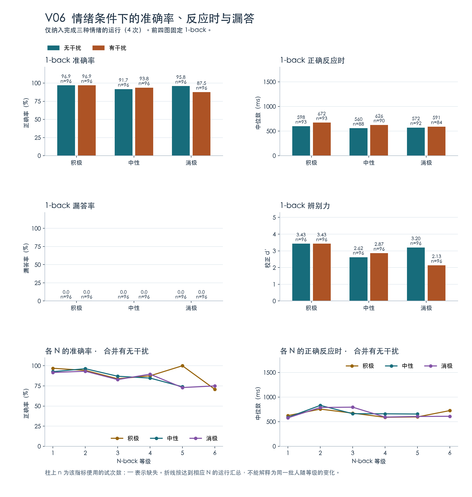
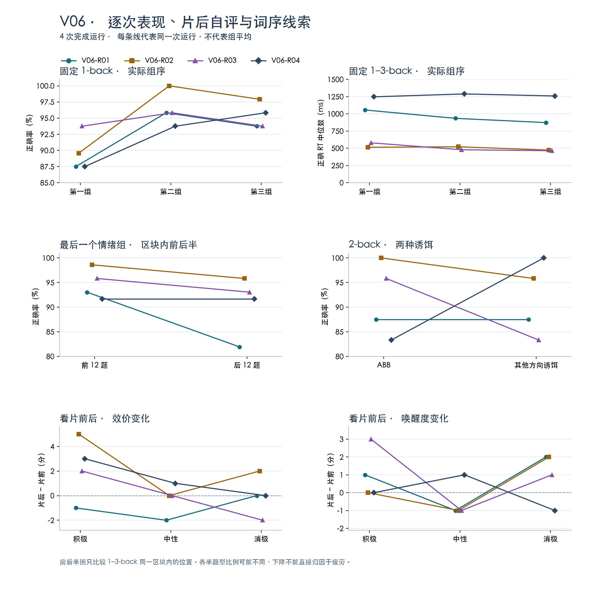

# V06 · 120 秒单次影片版的四次正式运行

[先看逐次图表与解读](逐次观察.md) · [逐次完整指标](逐次分析.md) · [逐次干扰差值、分类误报与自评](逐次配对.md) · [下载各次 ZIP](运行包) · [对应代码](../../代码包/V06.zip)

本批按原始运行时间将四次完整运行重编为 **V06-R01–R04**。排除原有 pilot（120 个计分试次，72 次漏答且未走完流程）。先前归档的完整运行只计一次，对应现编号 R01。正式分析含 **100 个区块、2,400 个计分试次、2,123 次正确和 5 次漏答**。原有[闪退摘要](运行包/V06-FAIL-01.zip)只作为工程证据。公开 ZIP 采用去标识化编号与相对时刻。四次运行的配置记录了诱导时长和音量。试次和播放日志用运行内素材代号（如 `stimulus-01`）记录播放次序，情绪条件以 `emotion` 字段为准。 [正式影片的时间码与校验值](../../文档/情绪素材.md#v06-正式实验)

## 一、同一 N 的行为表现

四次都完成了每种情绪下的 1–3-back。以下只用这三个共同等级，每次、每种情绪均有 144 个计分试次，避免把较少人达到的高 N 混作不同条件的直接比较。d′ 基于有效 J/F 作答，命中和虚报采用加 0.5／分母加 1 的校正。正确率计入漏答。

| 影片条件 | 正确／计分 | 正确 RT 中位数（合并试次） | 校正 d′（合并试次） | 校正 d′（运行等权平均） |
|---|---:|---:|---:|---:|
| 积极 | 528/576（91.7%） | 688 ms | 2.72 | 2.81 |
| 中性 | 530/576（92.0%） | 655 ms | 2.73 | 2.74 |
| 消极 | 514/576（89.2%） | 688 ms | 2.39 | 2.63 |

**以运行作为干扰比较的汇总单位。** 在共同完成的 1–3-back 内，每次运行有 9 对同情绪、同 N 的有无干扰区块。取各对正确反应时差的中位数，有干扰时三次变慢、一次变快。取各对正确率差的均值，两次上升、两次下降。同一影片条件下，差值方向也随运行而变。 [逐次差值及公式](逐次配对.md)

消极条件的汇总正确率较低。分开看各次运行，R01、R04 在消极条件下正确率最低，R02 的积极和消极条件并列最高，R03 的消极条件最高。两种校正 d′ 的汇总值均是消极条件较低，按运行等权后差距较小。四次运行中三次先做消极、一次先做中性，积极条件均未排在第一。

补充：区块级配对统计

36 对同情绪、同 N 的区块中，有干扰时正确率较高、较低及持平的配对数为 13、14、9，平均差 −0.69 个百分点。正确反应时较慢、较快的配对数为 23、13，配对差中位数为 +9.7 ms。这 36 对来自上述四次运行。

## 二、复核问卷反馈

以下组序、区块前后半段及 ABB 比较是基于现有记录的探索性复核。

### 熟悉任务后的组间表现

被试在问卷中提到，热身以后还会继续熟悉规则，并感到注意更集中。下表固定 N，按实际经历的三个情绪组比较。四次运行的第二组 1-back 均比首组答得准。要分辨熟练程度与影片条件的作用，下一轮需要更均衡的情绪顺序，并单独记录热身表现和注意自评。

| 等级 | 第一组→第二组→第三组正确数 | 正确 RT 中位数 |
|---|---|---|
| 1-back | 172/192 → 185/192 → 183/192 | 595 → 579 → 598 ms |
| 1–3-back | 511/576 → 527/576 → 534/576 | 706 → 655 → 648 ms |

### 连续作答时的区块后半表现

为检查被试提到的后段负担，我们比较每个 1–3-back 区块的前 12 题和后 12 题。最后一个情绪组内，R01 后半少答对 8 题，R02、R03 各少答对 2 题，R04 持平。由于前后半的题型分布不同，下一轮可平衡题型并记录组末疲劳评分。

| 取样范围 | 前 12 题→后 12 题正确数 | 正确 RT 中位数 |
|---|---|---|
| 所有情绪组 | 807/864（93.4%）→ 765/864（88.5%） | [查看各次记录](逐次观察.md) |
| 最后一个情绪组 | 273/288（94.8%）→ 261/288（90.6%） | 647 → 648 ms |

所有情绪组合并看，后半诱饵较多（328 对 248），新词较少（71 对 241）。单列题型，匹配题由 256/283 变为 245/293，诱饵由 224/248 变为 289/328。

### 120 秒影片的唤醒强度与维持

| 条件 | 效价平均变化 | 唤醒度平均变化 | 片后平均唤醒度 |
|---|---:|---:|---:|
| 积极 | +2.25 | +1.0 | 5.75 |
| 中性 | −0.25 | −0.5 | 4.50 |
| 消极 | 0.00 | +1.0 | 4.75 |

按运行查看片前与片后的绝对分，可见到同样的变化量可能来自不同起点。见[片前片后自评图](逐次配对.md#看片前后自评)。积极片四次效价分别变化 −1、+5、+2、+3 分，消极片分别变化 0、+2、−2、0 分。被试反馈影片的唤醒度偏低，到 2-back 之后感觉情绪已经减弱。现有自评发生在看片前和看片后。影片结束到 2-back 开始相隔 96–163 秒，中位数为 123 秒。到 3-back 开始相隔 197–314 秒，中位数约 260 秒。下一轮可增加等级间自评，直接追踪影片引起的情绪能维持多久。

### 2-back 的 ABB 线索及词序设计的作用

ABB 指紧邻三个中央词为 A、B、B 且 A≠B。问的是当前 B 是否等于前两步 A，因此正确键是 **F**。当前生成器禁止 AAA。实测的 24 个 2-back 区块里，每块恰好四个 ABB，共 **96/96 个 ABB 都是 N−1 诱饵，应按 F**。每次运行的每种情绪各有 8 个 ABB。只看到“当前词等于上一个词”在这批生成序列上就能回答这些项目，这是可靠的结构性线索。

实际答题中，ABB 与另一个方向诱饵都是 **88/96** 正确，正确 RT 中位数约 **834 与 833 ms**。逐次结果有的 ABB 快、有的慢，不能据此断定被试都识别或利用了这条规则。敏感性复核中，从共同 1–3-back 剔除 ABB 后，积极、中性、消极分别为 **499/544、499/544、486/544**，剔除后，积极与中性正确数相同，消极仍较低。

同一套生成规则能控制跨情绪条件的试次配额，像本批 ABB 数量就相同；仍要检查实际词序难度、反复间距和被试是否随练习改变策略。若所有条件都能借同一捷径得分，情绪对比仍可能测到“记忆加策略”的综合表现。识别词语熟悉或大致距离可以作为保留了部分信息的行为指标，单凭这些反应无法定位为精确工作记忆。建议同时报告真正匹配命中、按 N−1／N+1 分类的误报、普通熟悉非匹配及首次出现非匹配。共同 1–3-back 中，首次出现非匹配为 **311/312** 正确、RT 中位数 **579 ms**，已出现普通非匹配为 **247/264、672 ms**，说明分开看这些指标有信息。逐次比较中，四次运行的 N+1 诱饵误报率都高于首次出现的非匹配。各类试次所处等级和序列位置可能不同，因此这项差异用于描述错误集中在哪些题型。

## 三、如何改进下一轮

1. **先单独验证影片。** 在目标被试中用清晰、听辨一致的素材做小样本筛选。把效价目标和正负唤醒度匹配作为判据，保留中性低唤醒。比较短维持片与无维持片，在安排升级的版本中可于每次升 N 后播放相应情绪的短维持片，并在部分运行里在 2-back 后抽测状态。以能维持诱导且不明显增加时长的最短时长为准。若采用固定个人最高 N 的方案，需要另行确定按区块而非升级维持的规则。
2. **把词序的结构公平与测量效度同时验证。** 保留跨条件同一生成机制和 A/B 配对。对 2-back 比较不同的诱饵设计，避免相邻重复总是暗示 F。由于 2-back 的 N−1 诱饵就是上一步重复，去除全部 ABB 会改变现有诱饵配额，需要重新定义类别或重新设计合法的相邻重复对照，再做独立预试。可对同等级的误报率、正确 RT 和定性策略报告做交叉验证。
3. **控制练习、时长与疲劳。** 保留 1–3-back 热身，可记录是否掌握按键并达到预设练习标准。正式流程均衡情绪顺序。比较固定个人最高 N 的方案时，以区块末简短评分、漏答和同难度下的前后差诊断疲劳，尽量缩短单次流程。当前四次从准备页至最后组结束约 26.9–40.6 分钟，耐受时长的个体差异来自问卷反馈，尚未量化。
4. **统一环境。** 保持室内安静，固定设备、音量、屏幕亮度和室内照度。问卷提出在消极条件使用暗光以加强情境。如果只有该条件改变照度，灯光与影片就同时变化。若要研究情境光照，建议另做预测试，或把照度设为单独、可对照的变量。

复算入口：[通用工具与 V06 专项脚本](../复算工具/README.md)。上述分析均为四次运行的描述性比较，问卷来自实验组织者整理，未取得逐人原始问卷。
