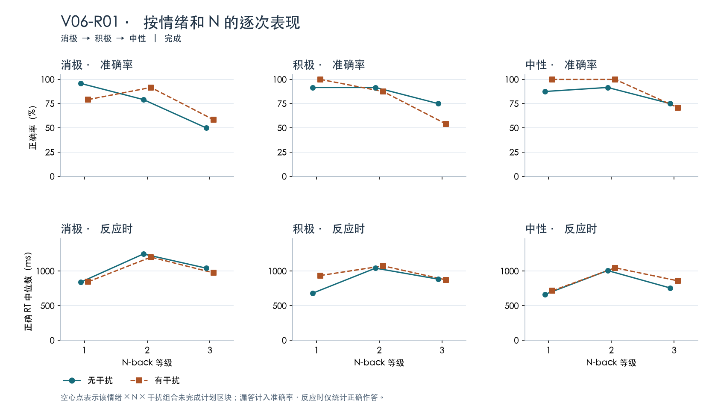
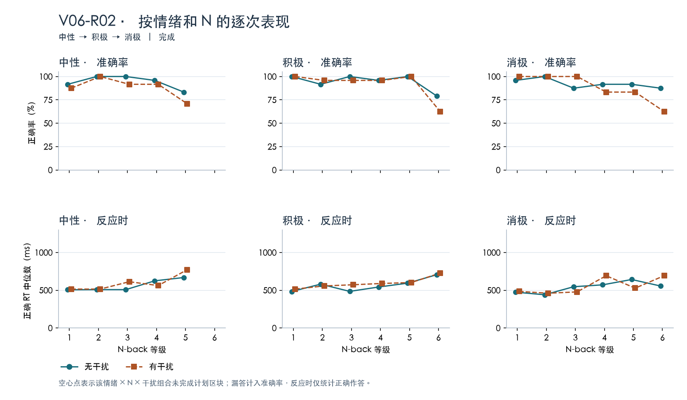
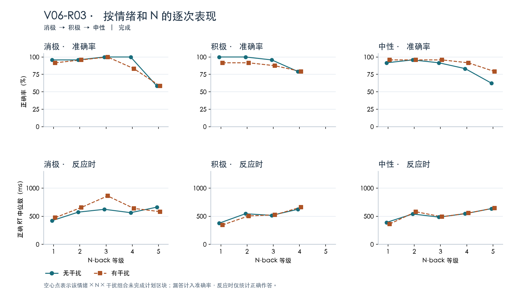
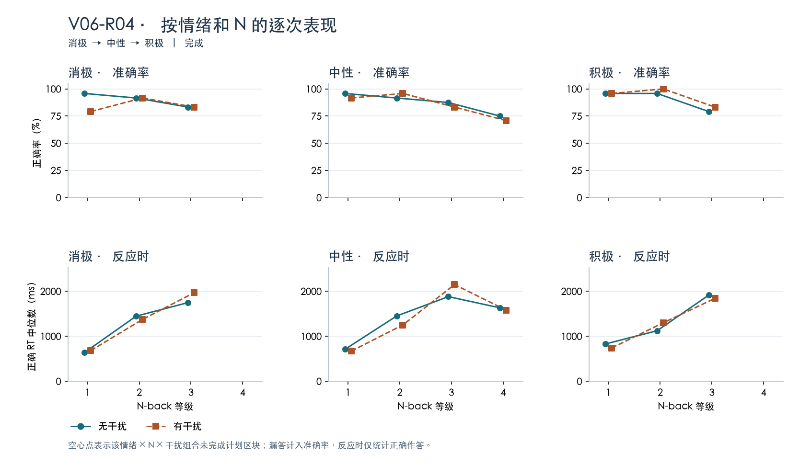

# V06 逐次运行分析

[返回版本汇总](README.md) · [逐次分析索引](../README.md)

每个编号是一次去标识化运行。档案无法确认哪些编号属于同一人。漏答计入正确率分母，RT 中位数仅用正确且有记录的 J/F 作答，校正 d′ 按有效作答计算。有完整区块日志且达到计划区块数的条件才在图中连线。

[V06-R01](#v06-r01) · [V06-R02](#v06-r02) · [V06-R03](#v06-r03) · [V06-R04](#v06-r04)

[逐次解读与问卷复核](逐次观察.md) · [新版汇总](README.md)

### V06-R01

[原始数据 ZIP](运行包/V06-R01.zip) · 状态：完成 · 计划顺序：消极 → 积极 → 中性

整体正确 **355/432（82.2%）**，漏答 1，正确 RT 中位数 935 ms，最高通过 N（积极／中性／消极）为 2／2／2。

| 情绪 | N | 干扰 | 完成／计划区块 | 正确／计分 | 漏答 | 正确 RT 中位数（ms） | 命中／有效匹配 | 虚报／有效非匹配 | 校正 d′ |
| --- | --- | --- | --- | --- | --- | --- | --- | --- | --- |
| 消极 | 1 | 无干扰 | 1/1 | 23/24（95.8%） | 0 | 839 | 8/8（100.0%） | 1/16（6.2%） | 2.94 |
| 消极 | 1 | 有干扰 | 1/1 | 19/24（79.2%） | 0 | 845 | 7/8（87.5%） | 4/16（25.0%） | 1.60 |
| 消极 | 2 | 无干扰 | 1/1 | 19/24（79.2%） | 0 | 1246 | 6/8（75.0%） | 3/16（18.8%） | 1.41 |
| 消极 | 2 | 有干扰 | 1/1 | 22/24（91.7%） | 1 | 1201 | 8/8（100.0%） | 1/15（6.7%） | 2.91 |
| 消极 | 3 | 无干扰 | 1/1 | 12/24（50.0%） | 0 | 1042 | 1/8（12.5%） | 5/16（31.2%） | -0.51 |
| 消极 | 3 | 有干扰 | 1/1 | 14/24（58.3%） | 0 | 973 | 3/8（37.5%） | 5/16（31.2%） | 0.18 |
| 积极 | 1 | 无干扰 | 1/1 | 22/24（91.7%） | 0 | 680 | 7/8（87.5%） | 1/16（6.2%） | 2.32 |
| 积极 | 1 | 有干扰 | 1/1 | 24/24（100.0%） | 0 | 935 | 8/8（100.0%） | 0/16（0.0%） | 3.48 |
| 积极 | 2 | 无干扰 | 1/1 | 22/24（91.7%） | 0 | 1042 | 6/8（75.0%） | 0/16（0.0%） | 2.48 |
| 积极 | 2 | 有干扰 | 1/1 | 21/24（87.5%） | 0 | 1074 | 7/8（87.5%） | 2/16（12.5%） | 2.02 |
| 积极 | 3 | 无干扰 | 1/1 | 18/24（75.0%） | 0 | 883 | 5/8（62.5%） | 3/16（18.8%） | 1.10 |
| 积极 | 3 | 有干扰 | 1/1 | 13/24（54.2%） | 0 | 873 | 5/8（62.5%） | 8/16（50.0%） | 0.28 |
| 中性 | 1 | 无干扰 | 1/1 | 21/24（87.5%） | 0 | 662 | 7/8（87.5%） | 2/16（12.5%） | 2.02 |
| 中性 | 1 | 有干扰 | 1/1 | 24/24（100.0%） | 0 | 715 | 8/8（100.0%） | 0/16（0.0%） | 3.48 |
| 中性 | 2 | 无干扰 | 1/1 | 22/24（91.7%） | 0 | 1007 | 7/8（87.5%） | 1/16（6.2%） | 2.32 |
| 中性 | 2 | 有干扰 | 1/1 | 24/24（100.0%） | 0 | 1047 | 8/8（100.0%） | 0/16（0.0%） | 3.48 |
| 中性 | 3 | 无干扰 | 1/1 | 18/24（75.0%） | 0 | 755 | 6/8（75.0%） | 4/16（25.0%） | 1.22 |
| 中性 | 3 | 有干扰 | 1/1 | 17/24（70.8%） | 0 | 859 | 4/8（50.0%） | 3/16（18.8%） | 0.82 |

漏答比例最高的组合是 **消极 · 2-back · 有干扰**（1/24（4.2%））。

**固定 1-back 的实际组序**：消极 42/48（87.5%） → 积极 46/48（95.8%） → 中性 45/48（93.8%）。

有干扰准确率较高／较低／持平为 **5／4／0**。下表均为同一情绪、同一 N 内的「有干扰减无干扰」。

| 情绪 | N | 准确率差（百分点） | 正确 RT 中位数差（ms） | 校正 d′ 差 | 漏答数差 |
| --- | --- | --- | --- | --- | --- |
| 消极 | 1 | -16.7 | +6 | -1.35 | 0 |
| 消极 | 2 | +12.5 | -46 | +1.50 | 1 |
| 消极 | 3 | +8.3 | -69 | +0.69 | 0 |
| 积极 | 1 | +8.3 | +255 | +1.16 | 0 |
| 积极 | 2 | -4.2 | +33 | -0.46 | 0 |
| 积极 | 3 | -20.8 | -10 | -0.82 | 0 |
| 中性 | 1 | +12.5 | +53 | +1.47 | 0 |
| 中性 | 2 | +8.3 | +40 | +1.16 | 0 |
| 中性 | 3 | -4.2 | +104 | -0.40 | 0 |

| 试次类型 | 正确／计分 | 正确 RT 中位数（ms） |
| --- | --- | --- |
| 匹配 | 111/144（77.1%） | 908 |
| 诱饵 | 116/144（80.6%） | 1034 |
| 其他非匹配·曾出现 | 51/66（77.3%） | 924 |
| 其他非匹配·首次出现 | 77/78（98.7%） | 822 |

| 影片条件 | 效价前→后 | 唤醒度前→后 |
| --- | --- | --- |
| 消极 | 5→5 | 1→3 |
| 积极 | 6→5 | 4→5 |
| 中性 | 7→5 | 6→5 |

### V06-R02

[原始数据 ZIP](运行包/V06-R02.zip) · 状态：完成 · 计划顺序：中性 → 积极 → 消极

整体正确 **747/816（91.5%）**，漏答 0，正确 RT 中位数 557 ms，最高通过 N（积极／中性／消极）为 5／4／6。

| 情绪 | N | 干扰 | 完成／计划区块 | 正确／计分 | 漏答 | 正确 RT 中位数（ms） | 命中／有效匹配 | 虚报／有效非匹配 | 校正 d′ |
| --- | --- | --- | --- | --- | --- | --- | --- | --- | --- |
| 中性 | 1 | 无干扰 | 1/1 | 22/24（91.7%） | 0 | 506 | 7/8（87.5%） | 1/16（6.2%） | 2.32 |
| 中性 | 1 | 有干扰 | 1/1 | 21/24（87.5%） | 0 | 515 | 6/8（75.0%） | 1/16（6.2%） | 1.94 |
| 中性 | 2 | 无干扰 | 1/1 | 24/24（100.0%） | 0 | 508 | 8/8（100.0%） | 0/16（0.0%） | 3.48 |
| 中性 | 2 | 有干扰 | 1/1 | 24/24（100.0%） | 0 | 515 | 8/8（100.0%） | 0/16（0.0%） | 3.48 |
| 中性 | 3 | 无干扰 | 1/1 | 24/24（100.0%） | 0 | 508 | 8/8（100.0%） | 0/16（0.0%） | 3.48 |
| 中性 | 3 | 有干扰 | 1/1 | 22/24（91.7%） | 0 | 612 | 7/8（87.5%） | 1/16（6.2%） | 2.32 |
| 中性 | 4 | 无干扰 | 1/1 | 23/24（95.8%） | 0 | 624 | 8/8（100.0%） | 1/16（6.2%） | 2.94 |
| 中性 | 4 | 有干扰 | 1/1 | 22/24（91.7%） | 0 | 562 | 8/8（100.0%） | 2/16（12.5%） | 2.64 |
| 中性 | 5 | 无干扰 | 1/1 | 20/24（83.3%） | 0 | 668 | 7/8（87.5%） | 3/16（18.8%） | 1.79 |
| 中性 | 5 | 有干扰 | 1/1 | 17/24（70.8%） | 0 | 772 | 4/8（50.0%） | 3/16（18.8%） | 0.82 |
| 积极 | 1 | 无干扰 | 1/1 | 24/24（100.0%） | 0 | 483 | 8/8（100.0%） | 0/16（0.0%） | 3.48 |
| 积极 | 1 | 有干扰 | 1/1 | 24/24（100.0%） | 0 | 515 | 8/8（100.0%） | 0/16（0.0%） | 3.48 |
| 积极 | 2 | 无干扰 | 1/1 | 22/24（91.7%） | 0 | 580 | 7/8（87.5%） | 1/16（6.2%） | 2.32 |
| 积极 | 2 | 有干扰 | 1/1 | 23/24（95.8%） | 0 | 557 | 7/8（87.5%） | 0/16（0.0%） | 2.86 |
| 积极 | 3 | 无干扰 | 1/1 | 24/24（100.0%） | 0 | 485 | 8/8（100.0%） | 0/16（0.0%） | 3.48 |
| 积极 | 3 | 有干扰 | 1/1 | 23/24（95.8%） | 0 | 572 | 8/8（100.0%） | 1/16（6.2%） | 2.94 |
| 积极 | 4 | 无干扰 | 1/1 | 23/24（95.8%） | 0 | 543 | 7/8（87.5%） | 0/16（0.0%） | 2.86 |
| 积极 | 4 | 有干扰 | 1/1 | 23/24（95.8%） | 0 | 590 | 7/8（87.5%） | 0/16（0.0%） | 2.86 |
| 积极 | 5 | 无干扰 | 1/1 | 24/24（100.0%） | 0 | 594 | 8/8（100.0%） | 0/16（0.0%） | 3.48 |
| 积极 | 5 | 有干扰 | 1/1 | 24/24（100.0%） | 0 | 602 | 8/8（100.0%） | 0/16（0.0%） | 3.48 |
| 积极 | 6 | 无干扰 | 1/1 | 19/24（79.2%） | 0 | 706 | 5/8（62.5%） | 2/16（12.5%） | 1.33 |
| 积极 | 6 | 有干扰 | 1/1 | 15/24（62.5%） | 0 | 727 | 3/8（37.5%） | 4/16（25.0%） | 0.35 |
| 消极 | 1 | 无干扰 | 1/1 | 23/24（95.8%） | 0 | 474 | 7/8（87.5%） | 0/16（0.0%） | 2.86 |
| 消极 | 1 | 有干扰 | 1/1 | 24/24（100.0%） | 0 | 484 | 8/8（100.0%） | 0/16（0.0%） | 3.48 |
| 消极 | 2 | 无干扰 | 1/1 | 24/24（100.0%） | 0 | 440 | 8/8（100.0%） | 0/16（0.0%） | 3.48 |
| 消极 | 2 | 有干扰 | 1/1 | 24/24（100.0%） | 0 | 460 | 8/8（100.0%） | 0/16（0.0%） | 3.48 |
| 消极 | 3 | 无干扰 | 1/1 | 21/24（87.5%） | 0 | 546 | 6/8（75.0%） | 1/16（6.2%） | 1.94 |
| 消极 | 3 | 有干扰 | 1/1 | 24/24（100.0%） | 0 | 478 | 8/8（100.0%） | 0/16（0.0%） | 3.48 |
| 消极 | 4 | 无干扰 | 1/1 | 22/24（91.7%） | 0 | 571 | 7/8（87.5%） | 1/16（6.2%） | 2.32 |
| 消极 | 4 | 有干扰 | 1/1 | 20/24（83.3%） | 0 | 692 | 4/8（50.0%） | 0/16（0.0%） | 1.89 |
| 消极 | 5 | 无干扰 | 1/1 | 22/24（91.7%） | 0 | 642 | 7/8（87.5%） | 1/16（6.2%） | 2.32 |
| 消极 | 5 | 有干扰 | 1/1 | 20/24（83.3%） | 0 | 528 | 8/8（100.0%） | 4/16（25.0%） | 2.22 |
| 消极 | 6 | 无干扰 | 1/1 | 21/24（87.5%） | 0 | 555 | 6/8（75.0%） | 1/16（6.2%） | 1.94 |
| 消极 | 6 | 有干扰 | 1/1 | 15/24（62.5%） | 0 | 692 | 4/8（50.0%） | 5/16（31.2%） | 0.46 |

**固定 1-back 的实际组序**：中性 43/48（89.6%） → 积极 48/48（100.0%） → 消极 47/48（97.9%）。

有干扰准确率较高／较低／持平为 **3／9／5**。下表均为同一情绪、同一 N 内的「有干扰减无干扰」。

| 情绪 | N | 准确率差（百分点） | 正确 RT 中位数差（ms） | 校正 d′ 差 | 漏答数差 |
| --- | --- | --- | --- | --- | --- |
| 中性 | 1 | -4.2 | +9 | -0.38 | 0 |
| 中性 | 2 | +0.0 | +7 | +0.00 | 0 |
| 中性 | 3 | -8.3 | +105 | -1.16 | 0 |
| 中性 | 4 | -4.2 | -63 | -0.30 | 0 |
| 中性 | 5 | -12.5 | +104 | -0.97 | 0 |
| 积极 | 1 | +0.0 | +32 | +0.00 | 0 |
| 积极 | 2 | +4.2 | -24 | +0.54 | 0 |
| 积极 | 3 | -4.2 | +88 | -0.54 | 0 |
| 积极 | 4 | +0.0 | +47 | +0.00 | 0 |
| 积极 | 5 | +0.0 | +8 | +0.00 | 0 |
| 积极 | 6 | -16.7 | +22 | -0.98 | 0 |
| 消极 | 1 | +4.2 | +10 | +0.63 | 0 |
| 消极 | 2 | +0.0 | +20 | +0.00 | 0 |
| 消极 | 3 | +12.5 | -68 | +1.54 | 0 |
| 消极 | 4 | -8.3 | +121 | -0.43 | 0 |
| 消极 | 5 | -8.3 | -114 | -0.10 | 0 |
| 消极 | 6 | -25.0 | +137 | -1.48 | 0 |

| 试次类型 | 正确／计分 | 正确 RT 中位数（ms） |
| --- | --- | --- |
| 匹配 | 236/272（86.8%） | 535 |
| 诱饵 | 248/272（91.2%） | 624 |
| 其他非匹配·曾出现 | 147/156（94.2%） | 556 |
| 其他非匹配·首次出现 | 116/116（100.0%） | 473 |

| 影片条件 | 效价前→后 | 唤醒度前→后 |
| --- | --- | --- |
| 中性 | 5→5 | 6→5 |
| 积极 | 1→6 | 5→5 |
| 消极 | 2→4 | 4→6 |

### V06-R03

[原始数据 ZIP](运行包/V06-R03.zip) · 状态：完成 · 计划顺序：消极 → 积极 → 中性

整体正确 **597/672（88.8%）**，漏答 0，正确 RT 中位数 539 ms，最高通过 N（积极／中性／消极）为 3／4／4。

| 情绪 | N | 干扰 | 完成／计划区块 | 正确／计分 | 漏答 | 正确 RT 中位数（ms） | 命中／有效匹配 | 虚报／有效非匹配 | 校正 d′ |
| --- | --- | --- | --- | --- | --- | --- | --- | --- | --- |
| 消极 | 1 | 无干扰 | 1/1 | 23/24（95.8%） | 0 | 421 | 8/8（100.0%） | 1/16（6.2%） | 2.94 |
| 消极 | 1 | 有干扰 | 1/1 | 22/24（91.7%） | 0 | 474 | 6/8（75.0%） | 0/16（0.0%） | 2.48 |
| 消极 | 2 | 无干扰 | 1/1 | 23/24（95.8%） | 0 | 572 | 7/8（87.5%） | 0/16（0.0%） | 2.86 |
| 消极 | 2 | 有干扰 | 1/1 | 23/24（95.8%） | 0 | 656 | 8/8（100.0%） | 1/16（6.2%） | 2.94 |
| 消极 | 3 | 无干扰 | 1/1 | 24/24（100.0%） | 0 | 623 | 8/8（100.0%） | 0/16（0.0%） | 3.48 |
| 消极 | 3 | 有干扰 | 1/1 | 24/24（100.0%） | 0 | 861 | 8/8（100.0%） | 0/16（0.0%） | 3.48 |
| 消极 | 4 | 无干扰 | 1/1 | 24/24（100.0%） | 0 | 563 | 8/8（100.0%） | 0/16（0.0%） | 3.48 |
| 消极 | 4 | 有干扰 | 1/1 | 20/24（83.3%） | 0 | 639 | 5/8（62.5%） | 1/16（6.2%） | 1.63 |
| 消极 | 5 | 无干扰 | 1/1 | 14/24（58.3%） | 0 | 661 | 2/8（25.0%） | 4/16（25.0%） | 0.04 |
| 消极 | 5 | 有干扰 | 1/1 | 14/24（58.3%） | 0 | 581 | 2/8（25.0%） | 4/16（25.0%） | 0.04 |
| 积极 | 1 | 无干扰 | 1/1 | 24/24（100.0%） | 0 | 377 | 8/8（100.0%） | 0/16（0.0%） | 3.48 |
| 积极 | 1 | 有干扰 | 1/1 | 22/24（91.7%） | 0 | 344 | 7/8（87.5%） | 1/16（6.2%） | 2.32 |
| 积极 | 2 | 无干扰 | 1/1 | 24/24（100.0%） | 0 | 544 | 8/8（100.0%） | 0/16（0.0%） | 3.48 |
| 积极 | 2 | 有干扰 | 1/1 | 22/24（91.7%） | 0 | 505 | 8/8（100.0%） | 2/16（12.5%） | 2.64 |
| 积极 | 3 | 无干扰 | 1/1 | 23/24（95.8%） | 0 | 515 | 8/8（100.0%） | 1/16（6.2%） | 2.94 |
| 积极 | 3 | 有干扰 | 1/1 | 21/24（87.5%） | 0 | 524 | 7/8（87.5%） | 2/16（12.5%） | 2.02 |
| 积极 | 4 | 无干扰 | 1/1 | 19/24（79.2%） | 0 | 623 | 4/8（50.0%） | 1/16（6.2%） | 1.35 |
| 积极 | 4 | 有干扰 | 1/1 | 19/24（79.2%） | 0 | 662 | 7/8（87.5%） | 4/16（25.0%） | 1.60 |
| 中性 | 1 | 无干扰 | 1/1 | 22/24（91.7%） | 0 | 390 | 7/8（87.5%） | 1/16（6.2%） | 2.32 |
| 中性 | 1 | 有干扰 | 1/1 | 23/24（95.8%） | 0 | 362 | 7/8（87.5%） | 0/16（0.0%） | 2.86 |
| 中性 | 2 | 无干扰 | 1/1 | 23/24（95.8%） | 0 | 540 | 8/8（100.0%） | 1/16（6.2%） | 2.94 |
| 中性 | 2 | 有干扰 | 1/1 | 23/24（95.8%） | 0 | 579 | 8/8（100.0%） | 1/16（6.2%） | 2.94 |
| 中性 | 3 | 无干扰 | 1/1 | 22/24（91.7%） | 0 | 484 | 8/8（100.0%） | 2/16（12.5%） | 2.64 |
| 中性 | 3 | 有干扰 | 1/1 | 23/24（95.8%） | 0 | 489 | 7/8（87.5%） | 0/16（0.0%） | 2.86 |
| 中性 | 4 | 无干扰 | 1/1 | 20/24（83.3%） | 0 | 544 | 8/8（100.0%） | 4/16（25.0%） | 2.22 |
| 中性 | 4 | 有干扰 | 1/1 | 22/24（91.7%） | 0 | 556 | 6/8（75.0%） | 0/16（0.0%） | 2.48 |
| 中性 | 5 | 无干扰 | 1/1 | 15/24（62.5%） | 0 | 635 | 4/8（50.0%） | 5/16（31.2%） | 0.46 |
| 中性 | 5 | 有干扰 | 1/1 | 19/24（79.2%） | 0 | 647 | 4/8（50.0%） | 1/16（6.2%） | 1.35 |

**固定 1-back 的实际组序**：消极 45/48（93.8%） → 积极 46/48（95.8%） → 中性 45/48（93.8%）。

有干扰准确率较高／较低／持平为 **4／5／5**。下表均为同一情绪、同一 N 内的「有干扰减无干扰」。

| 情绪 | N | 准确率差（百分点） | 正确 RT 中位数差（ms） | 校正 d′ 差 | 漏答数差 |
| --- | --- | --- | --- | --- | --- |
| 消极 | 1 | -4.2 | +53 | -0.47 | 0 |
| 消极 | 2 | +0.0 | +84 | +0.09 | 0 |
| 消极 | 3 | +0.0 | +238 | +0.00 | 0 |
| 消极 | 4 | -16.7 | +76 | -1.85 | 0 |
| 消极 | 5 | +0.0 | -80 | +0.00 | 0 |
| 积极 | 1 | -8.3 | -33 | -1.16 | 0 |
| 积极 | 2 | -8.3 | -39 | -0.84 | 0 |
| 积极 | 3 | -8.3 | +9 | -0.93 | 0 |
| 积极 | 4 | +0.0 | +39 | +0.24 | 0 |
| 中性 | 1 | +4.2 | -28 | +0.54 | 0 |
| 中性 | 2 | +0.0 | +40 | +0.00 | 0 |
| 中性 | 3 | +4.2 | +5 | +0.21 | 0 |
| 中性 | 4 | +8.3 | +12 | +0.26 | 0 |
| 中性 | 5 | +16.7 | +12 | +0.89 | 0 |

| 试次类型 | 正确／计分 | 正确 RT 中位数（ms） |
| --- | --- | --- |
| 匹配 | 186/224（83.0%） | 534 |
| 诱饵 | 198/224（88.4%） | 573 |
| 其他非匹配·曾出现 | 109/120（90.8%） | 556 |
| 其他非匹配·首次出现 | 104/104（100.0%） | 490 |

| 影片条件 | 效价前→后 | 唤醒度前→后 |
| --- | --- | --- |
| 消极 | 5→3 | 3→4 |
| 积极 | 5→7 | 3→6 |
| 中性 | 5→5 | 3→2 |

### V06-R04

[原始数据 ZIP](运行包/V06-R04.zip) · 状态：完成 · 计划顺序：消极 → 中性 → 积极

整体正确 **424/480（88.3%）**，漏答 4，正确 RT 中位数 1284 ms，最高通过 N（积极／中性／消极）为 2／3／2。

| 情绪 | N | 干扰 | 完成／计划区块 | 正确／计分 | 漏答 | 正确 RT 中位数（ms） | 命中／有效匹配 | 虚报／有效非匹配 | 校正 d′ |
| --- | --- | --- | --- | --- | --- | --- | --- | --- | --- |
| 消极 | 1 | 无干扰 | 1/1 | 23/24（95.8%） | 0 | 639 | 7/8（87.5%） | 0/16（0.0%） | 2.86 |
| 消极 | 1 | 有干扰 | 1/1 | 19/24（79.2%） | 0 | 681 | 5/8（62.5%） | 2/16（12.5%） | 1.33 |
| 消极 | 2 | 无干扰 | 1/1 | 22/24（91.7%） | 0 | 1448 | 7/8（87.5%） | 1/16（6.2%） | 2.32 |
| 消极 | 2 | 有干扰 | 1/1 | 22/24（91.7%） | 0 | 1372 | 7/8（87.5%） | 1/16（6.2%） | 2.32 |
| 消极 | 3 | 无干扰 | 1/1 | 20/24（83.3%） | 0 | 1748 | 5/8（62.5%） | 1/16（6.2%） | 1.63 |
| 消极 | 3 | 有干扰 | 1/1 | 20/24（83.3%） | 0 | 1968 | 5/8（62.5%） | 1/16（6.2%） | 1.63 |
| 中性 | 1 | 无干扰 | 1/1 | 23/24（95.8%） | 0 | 710 | 8/8（100.0%） | 1/16（6.2%） | 2.94 |
| 中性 | 1 | 有干扰 | 1/1 | 22/24（91.7%） | 0 | 669 | 7/8（87.5%） | 1/16（6.2%） | 2.32 |
| 中性 | 2 | 无干扰 | 1/1 | 22/24（91.7%） | 0 | 1451 | 6/8（75.0%） | 0/16（0.0%） | 2.48 |
| 中性 | 2 | 有干扰 | 1/1 | 23/24（95.8%） | 0 | 1252 | 8/8（100.0%） | 1/16（6.2%） | 2.94 |
| 中性 | 3 | 无干扰 | 1/1 | 21/24（87.5%） | 0 | 1882 | 6/8（75.0%） | 1/16（6.2%） | 1.94 |
| 中性 | 3 | 有干扰 | 1/1 | 20/24（83.3%） | 1 | 2149 | 5/8（62.5%） | 0/15（0.0%） | 2.14 |
| 中性 | 4 | 无干扰 | 1/1 | 18/24（75.0%） | 1 | 1631 | 6/8（75.0%） | 3/15（20.0%） | 1.37 |
| 中性 | 4 | 有干扰 | 1/1 | 17/24（70.8%） | 1 | 1582 | 6/8（75.0%） | 4/15（26.7%） | 1.17 |
| 积极 | 1 | 无干扰 | 1/1 | 23/24（95.8%） | 0 | 829 | 7/8（87.5%） | 0/16（0.0%） | 2.86 |
| 积极 | 1 | 有干扰 | 1/1 | 23/24（95.8%） | 0 | 739 | 7/8（87.5%） | 0/16（0.0%） | 2.86 |
| 积极 | 2 | 无干扰 | 1/1 | 23/24（95.8%） | 0 | 1123 | 8/8（100.0%） | 1/16（6.2%） | 2.94 |
| 积极 | 2 | 有干扰 | 1/1 | 24/24（100.0%） | 0 | 1301 | 8/8（100.0%） | 0/16（0.0%） | 3.48 |
| 积极 | 3 | 无干扰 | 1/1 | 19/24（79.2%） | 0 | 1916 | 6/8（75.0%） | 3/16（18.8%） | 1.41 |
| 积极 | 3 | 有干扰 | 1/1 | 20/24（83.3%） | 1 | 1843 | 7/8（87.5%） | 2/15（13.3%） | 1.98 |

漏答比例最高的组合是 **中性 · 3-back · 有干扰**（1/24（4.2%））。

**固定 1-back 的实际组序**：消极 42/48（87.5%） → 中性 45/48（93.8%） → 积极 46/48（95.8%）。

有干扰准确率较高／较低／持平为 **3／4／3**。下表均为同一情绪、同一 N 内的「有干扰减无干扰」。

| 情绪 | N | 准确率差（百分点） | 正确 RT 中位数差（ms） | 校正 d′ 差 | 漏答数差 |
| --- | --- | --- | --- | --- | --- |
| 消极 | 1 | -16.7 | +41 | -1.53 | 0 |
| 消极 | 2 | +0.0 | -75 | +0.00 | 0 |
| 消极 | 3 | +0.0 | +220 | +0.00 | 0 |
| 中性 | 1 | -4.2 | -41 | -0.63 | 0 |
| 中性 | 2 | +4.2 | -199 | +0.47 | 0 |
| 中性 | 3 | -4.2 | +268 | +0.20 | 1 |
| 中性 | 4 | -4.2 | -50 | -0.20 | 0 |
| 积极 | 1 | +0.0 | -90 | +0.00 | 0 |
| 积极 | 2 | +4.2 | +178 | +0.54 | 0 |
| 积极 | 3 | +4.2 | -72 | +0.57 | 1 |

| 试次类型 | 正确／计分 | 正确 RT 中位数（ms） |
| --- | --- | --- |
| 匹配 | 131/160（81.9%） | 973 |
| 诱饵 | 136/160（85.0%） | 1411 |
| 其他非匹配·曾出现 | 73/76（96.1%） | 1624 |
| 其他非匹配·首次出现 | 84/84（100.0%） | 900 |

| 影片条件 | 效价前→后 | 唤醒度前→后 |
| --- | --- | --- |
| 消极 | 5→5 | 7→6 |
| 中性 | 4→5 | 5→6 |
| 积极 | 3→6 | 7→7 |

### V06-FAIL-01

[故障摘要 ZIP](运行包/V06-FAIL-01.zip)。影片结束时退出，无计分试次。
