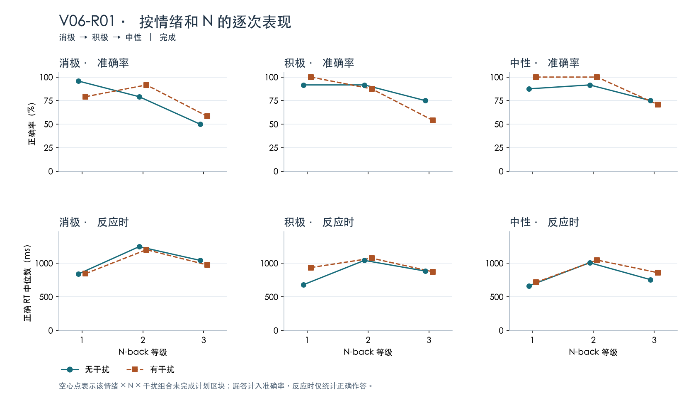
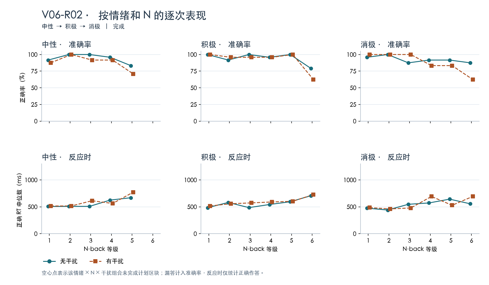
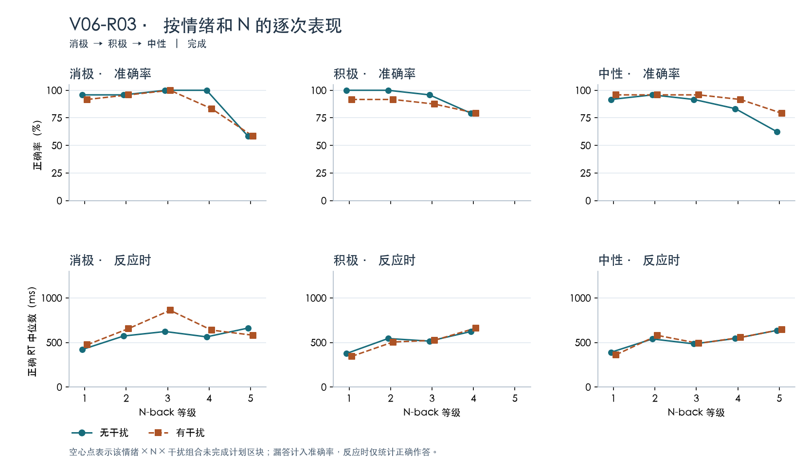
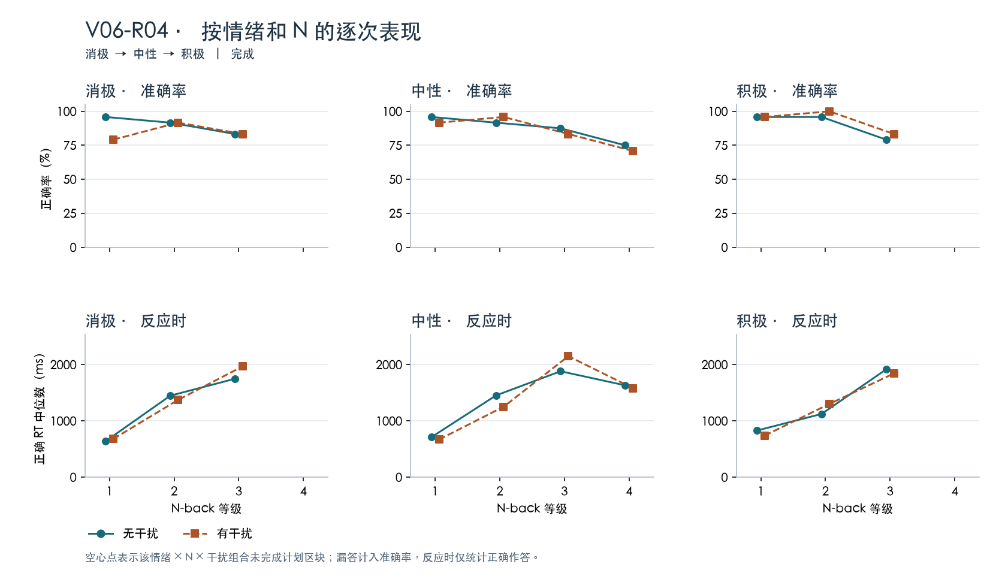

# V06 · 四次正式运行的图表与解读

[版本汇总](README.md) · [逐次指标与原始 ZIP](逐次分析.md)

剔除 pilot 后按原始运行时间重编 V06-R01 至 R04。准确率含漏答。下文“组序”按实际诱导先后排列，“区块内前半与后半”则在相同情绪、N 和干扰区块内比较，避免用更高 N 的结果直接和较低 N 比。正确 RT 取中位数。问卷反馈没有提供可用于逐人配对的编号，因此不会把某一项口述归给下列某一次运行。

| 运行 | 实际情绪顺序 | 全程正确／计分 | 展示准备至最后情绪组结束 | 最高通过 N（积极／中性／消极） |
|---|---|---:|---:|---|
| V06-R01 | 消极→积极→中性 | 355/432（82.2%） | 26.9 分钟 | 2／2／2 |
| V06-R02 | 中性→积极→消极 | 747/816（91.5%） | 40.6 分钟 | 5／4／6 |
| V06-R03 | 消极→积极→中性 | 597/672（88.8%） | 31.8 分钟 | 3／4／4 |
| V06-R04 | 消极→中性→积极 | 424/480（88.3%） | 31.7 分钟 | 2／3／2 |

## V06-R01

- **组序与熟练。** 固定 1-back，按组序为 42/48 → 46/48 → 45/48，正确 RT 为 840 → 782 → 691 ms。后组作答更快，第三组的正确率略低于第二组。
- **区块后半。** 共同 1–3-back 的区块前半 189/216、后半 166/216，RT 从 956 降到 916 ms。最后的中性组前半 67/72、后半 59/72，RT 几乎相同。后半准确率下降较明显，表现符合变快后错误增加或部分区块内注意波动，不能由作答单独确认疲劳。
- **自评与 ABB。** 消极影片效价 5→5、唤醒度 1→3。积极影片效价 6→5。2-back 的 ABB 与另一方向诱饵均答对 21/24。

[详细分条件表](逐次分析.md#v06-r01)

## V06-R02

- **组序与熟练。** 固定 1-back 为 43/48 → 48/48 → 47/48，RT 514 → 491 → 480 ms。后两组速度及正确率优于首组，第三组准确率略低于第二组。这是唯一中性先呈现的运行。
- **最长运行与后半表现。** 全程约 40.6 分钟，消极组到达 6-back 上限。共同 1–3-back 前半 211/216、后半 206/216，RT 491 → 514 ms。最后的消极组前后半为 71/72、69/72，RT 458 → 505 ms。长运行中观察到较小的后半准确率下降和变慢，全程合计无漏答。
- **自评与 ABB。** 积极效价 1→6，消极效价 2→4，消极唤醒度 4→6。ABB 24/24，另一方向诱饵 23/24，两类 RT 中位数 498 与 622 ms。这里的 ABB 更快，与其他运行并不一致。

[详细分条件表](逐次分析.md#v06-r02)

## V06-R03

- **速度提高，正确率变化较小。** 固定 1-back 为 45/48 → 46/48 → 45/48，RT 438 → 359 → 372 ms。合并共同 1–3-back，按组序答对 139 → 136 → 136 题（各 144 题），RT 579 → 479 → 464 ms。速度上升和正确率上升没有同步。
- **区块后半。** 共同等级前半 210/216、后半 201/216，RT 508 → 489 ms。最后中性组前半 69/72、后半 67/72，RT 480 → 445 ms。速度与准确率可能有取舍，不能单凭这一方向判断注意更集中或更疲劳。
- **自评与 ABB。** 消极效价 5→3，积极效价 5→7、唤醒度 3→6。ABB 23/24，另一方向诱饵 20/24，但 ABB 正确作答约慢 30 ms。

[详细分条件表](逐次分析.md#v06-r03)

## V06-R04

- **组序与熟练。** 固定 1-back 为 42/48 → 45/48 → 46/48，而 RT 674 → 678 → 772 ms。准确率随组序上升，但并没有同时变快。
- **区块后半。** 共同等级前半 197/216、后半 192/216，RT 1261 → 1263 ms。最后积极组前、后半均为 66/72，RT 1214 → 1289 ms。没有看到最后组的准确率下降，末半反应较慢。
- **自评与 ABB。** 消极效价 5→5、唤醒度 7→6，积极效价 3→6、唤醒度 7→7。ABB 20/24，另一方向诱饵 24/24。ABB 正确 RT 中位数 1706 ms，比另一方向的 1338 ms 更慢。

[详细分条件表](逐次分析.md#v06-r04)
