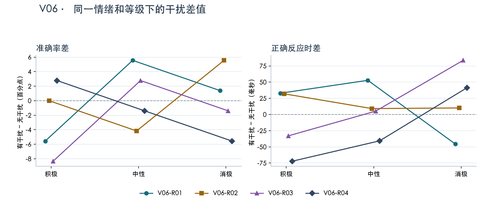
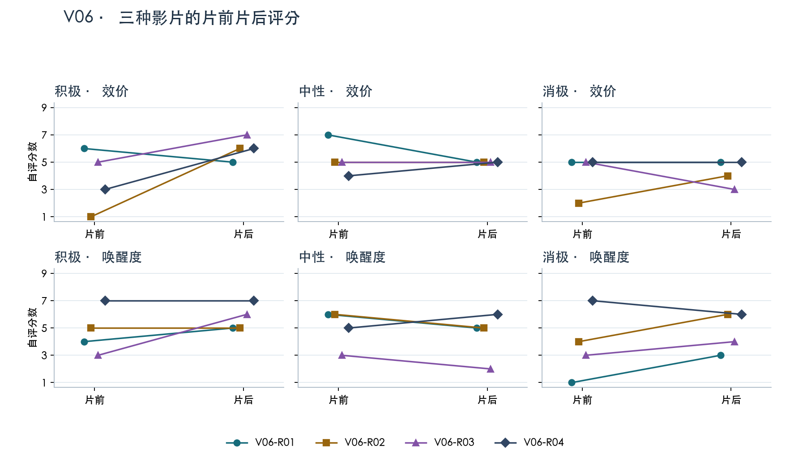

# V06 · 逐次配对与作答类型

> 由 [V06反馈复核.py](../复算工具/V06反馈复核.py) 生成。分析对象为四次正式运行共同完成的 1–3-back。

## 有干扰减去无干扰

同一次运行、同一情绪、同一 N 内配对。准确率列为各对准确率差的均值（百分点），反应时列为各对正确反应时中位数之差的中位数（毫秒）。每种情绪每次含 3 对，合计列含 9 对。正的反应时差表示有干扰时更慢。

| 运行 | 积极（百分点 / ms） | 中性（百分点 / ms） | 消极（百分点 / ms） | 三种情绪合计（百分点 / ms） |
| --- | ---: | ---: | ---: | ---: |
| V06-R01 | -5.56 / +32.9 | +5.56 / +52.8 | +1.39 / -45.5 | +0.46 / +32.9 |
| V06-R02 | +0.00 / +31.9 | -4.17 / +9.2 | +5.56 / +10.1 | +0.46 / +10.1 |
| V06-R03 | -8.33 / -33.0 | +2.78 / +5.2 | -1.39 / +83.6 | -2.31 / +9.3 |
| V06-R04 | +2.78 / -72.2 | -1.39 / -40.7 | -5.56 / +41.4 | -1.39 / -40.7 |

## 各次运行的情绪条件表现

每格为正确率（%）/ 校正辨别力 d′。每次每种情绪有 144 个计分试次。最后一行按运行等权求平均，d′ 先在各次运行内计算。

| 运行 | 积极 | 中性 | 消极 |
| --- | ---: | ---: | ---: |
| V06-R01 | 83.3 / 1.83 | 87.5 / 2.18 | 75.7 / 1.31 |
| V06-R02 | 97.2 / 3.58 | 95.1 / 3.13 | 97.2 / 3.62 |
| V06-R03 | 94.4 / 3.13 | 94.4 / 3.05 | 96.5 / 3.41 |
| V06-R04 | 91.7 / 2.71 | 91.0 / 2.62 | 87.5 / 2.16 |
| 运行等权均值 | 91.7 / 2.81 | 92.0 / 2.74 | 89.2 / 2.63 |

## 匹配与非匹配的作答

合并三种情绪及有无干扰。每格为按 J 的次数 / 该类有效 J/F 作答数。匹配列是命中，其余是误报。N−1 诱饵只取 2–3-back，1-back 不适用。漏答不进这些比率的分母。

| 运行 | 匹配命中 | N−1 诱饵误报 | N+1 诱饵误报 | 熟悉非匹配误报 | 首次出现非匹配误报 |
| --- | ---: | ---: | ---: | ---: | ---: |
| V06-R01 | 111/144 | 6/47 | 21/96 | 15/66 | 1/78 |
| V06-R02 | 135/144 | 0/48 | 6/96 | 0/66 | 0/78 |
| V06-R03 | 136/144 | 1/48 | 10/96 | 2/66 | 0/78 |
| V06-R04 | 119/144 | 7/48 | 9/94 | 0/66 | 0/78 |

## 看片前后自评

每条线连接同一次运行在同一影片条件下的片前与片后绝对分数。纵轴统一为 1–9 分。

[返回 V06 汇总](README.md)
