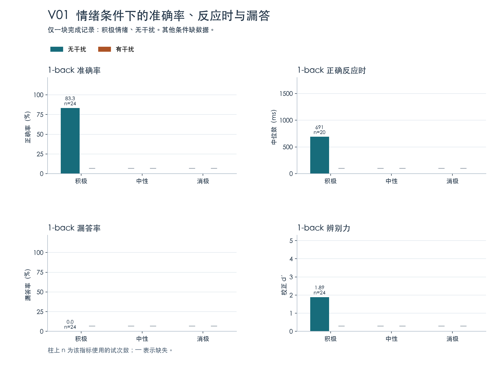

# V01 · 早期 Builder

[返回跨版本分析](README.md) · [对应代码](../../代码包/V01.zip) · [设计与版本](../../设计与版本.md) · [反馈与改进](../../反馈与改进.md)

**单次运行单独看：** [打开 V01 的逐次图表和数据](逐次分析/V01.md)。

## 情绪表现图

V01 只绘制唯一有区块汇总的 24 个试次，即积极情绪、无干扰的 1-back。其余条件无完整区块；不连等级趋势。

## 运行记录与核对

运行清单共 1 份，完成 0、部分 1、无计分 0。逐试次复核 25 个计分试次、1 个有区块汇总的区块、0 个有等级判定的有无干扰配对。另有 1 个已写试次但没有区块汇总的区块。

| 运行包 | 状态 | 情绪顺序（计划） | 正确／计分 | 漏答 | 正确 RT 中位数（ms） | 完成区块 | 试次历时和（分） | 最高 N（积极／中性／消极） |
| --- | --- | --- | --- | --- | --- | --- | --- | --- |
| [V01-R01](../V01-R01.zip) | 部分运行 | 积极→消极→中性 | 21/25（84.0%） | 0 | 690 | 1 | — | —／—／— |

试次历时和取日志字段 trial_elapsed_seconds 的加总，含启动词。它只反映记录下来的试次时间，不等于全程用时。最高 N 的 0 表示 1-back 未达升级线。

## 这版数据支持什么改动

- **可运行性。** 完整的第一块是积极、1-back、无干扰，24 题答对 20 题。命中 4/8，虚报 0/16，正确 RT 均值约 758 ms，程序记录该区块未通过。另一个区块只留下 1 道计分题。只看 83.3% 的区块正确率，会忽略命中率只有 50%。
- **与设计改动的关系。** 这可作为后续分别报告命中与虚报的理由，也适合用来检查启动、计分和阶段落盘。其后采用任一干扰条件正确率过线的阶梯，这是程序设计变更。此处只有一个完整区块，无法从本版验证新阈值是否更合适或估计有无干扰的差异。
- **与情绪反馈的关系。** 该运行没有情绪前后评分，后续增加音频用于增强诱导是设计动机。此处的行为数据无法测量音频加入前的诱导强度。
