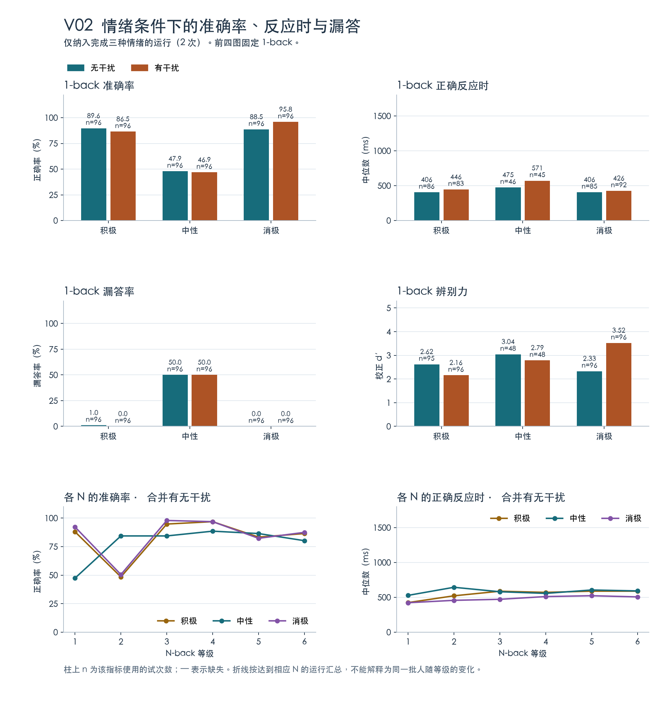

# V02 · 图片加音频、同字号同颜色、80% 阶梯

[返回跨版本分析](README.md) · [对应代码](../../代码包/V02.zip) · [设计与版本](../../设计与版本.md) · [反馈与改进](../../反馈与改进.md)

**单次运行单独看：** [打开 V02 的逐次图表和数据](逐次分析/V02.md)。

## 情绪表现图

上四图固定 1-back，分情绪比较有无干扰。下两图按 N 合并有无干扰，较高 N 只汇总实际达到该等级的运行。正确反应时使用中位数，柱上 n 为该指标实际纳入的试次数。

## 运行记录与核对

运行清单共 6 份，完成 2、部分 4、无计分 0。逐试次复核 2285 个计分试次、95 个有区块汇总的区块、23 个有等级判定的有无干扰配对。另有 2 个已写试次但没有区块汇总的区块。

| 运行包 | 状态 | 情绪顺序（计划） | 正确／计分 | 漏答 | 正确 RT 中位数（ms） | 完成区块 | 试次历时和（分） | 最高 N（积极／中性／消极） |
| --- | --- | --- | --- | --- | --- | --- | --- | --- |
| [V02-R01](../V02-R01.zip) | 完成 | 消极→中性→积极 | 166/480（34.6%） | 286 | 392 | 20 | 15.45 | 1／0／1 |
| [V02-R02](../V02-R02.zip) | 完成 | 中性→积极→消极 | 1565/1728（90.6%） | 4 | 542 | 72 | 36.58 | 6／6／6 |
| [V02-R03](../V02-R03.zip) | 部分运行 | 中性→积极→消极 | 0/2（0.0%） | 2 | — | 0 | 0.10 | —／—／— |
| [V02-R04](../V02-R04.zip) | 部分运行 | 积极→消极→中性 | 20/24（83.3%） | 0 | 374 | 1 | 0.38 | —／—／— |
| [V02-R05](../V02-R05.zip) | 部分运行 | 积极→中性→消极 | 1/3（33.3%） | 2 | 972 | 0 | 0.13 | —／—／— |
| [V02-R06](../V02-R06.zip) | 部分运行 | 消极→积极→中性 | 41/48（85.4%） | 0 | 371 | 2 | 0.77 | —／—／— |

试次历时和取日志字段 trial_elapsed_seconds 的加总，含启动词。它只反映记录下来的试次时间，不等于全程用时。最高 N 的 0 表示 1-back 未达升级线。

## 按 N 和试次类别

以下行为汇总只纳入完成三种情绪的运行。每一级或类别按试次汇总，运行贡献量可不同。

| 分组 | 正确／计分 | 漏答 | 正确 RT 中位数（ms） | 正确 RT 均值（ms） | 命中／目标作答 | 虚报／非目标作答 | 校正 d′ |
| --- | --- | --- | --- | --- | --- | --- | --- |
| 1-back | 437/576（75.9%） | 97 | 439 | 477 | 125/159（78.6%） | 8/320（2.5%） | 2.72 |
| 2-back | 271/480（56.5%） | 191 | 528 | 587 | 87/97（89.7%） | 8/192（4.2%） | 2.95 |
| 3-back | 266/288（92.4%） | 0 | 540 | 593 | 83/96（86.5%） | 9/192（4.7%） | 2.74 |
| 4-back | 271/288（94.1%） | 0 | 552 | 580 | 85/96（88.5%） | 6/192（3.1%） | 3.01 |
| 5-back | 242/288（84.0%） | 0 | 573 | 627 | 71/96（74.0%） | 21/192（10.9%） | 1.85 |
| 6-back | 244/288（84.7%） | 2 | 564 | 602 | 68/96（70.8%） | 14/190（7.4%） | 1.98 |

| 分组 | 正确／计分 | 漏答 | 正确 RT 中位数（ms） | 正确 RT 均值（ms） | 命中／目标作答 | 虚报／非目标作答 | 校正 d′ |
| --- | --- | --- | --- | --- | --- | --- | --- |
| 匹配 | 519/736（70.5%） | 96 | 573 | 602 | 519/640（81.1%） | — | — |
| 诱饵 | 194/279（69.5%） | 35 | 711 | 714 | — | 50/244（20.5%） | — |
| 其他非匹配·熟悉度不详 | 1018/1193（85.3%） | 159 | 499 | 521 | — | 16/1034（1.5%） | — |

## 同一 N 的情绪位置和干扰比较

固定 1-back，并分开显示情绪与干扰条件。校正 d′ 只计有效 J/F 作答，漏答单列，正确率仍以所有计分试次为分母。

| 分组 | 正确／计分 | 漏答 | 正确 RT 中位数（ms） | 正确 RT 均值（ms） | 命中／目标作答 | 虚报／非目标作答 | 校正 d′ |
| --- | --- | --- | --- | --- | --- | --- | --- |
| 积极 · 无干扰 | 86/96（89.6%） | 1 | 406 | 439 | 23/31（74.2%） | 1/64（1.6%） | 2.62 |
| 积极 · 有干扰 | 83/96（86.5%） | 0 | 446 | 486 | 21/32（65.6%） | 2/64（3.1%） | 2.16 |
| 中性 · 无干扰 | 46/96（47.9%） | 48 | 475 | 500 | 15/16（93.8%） | 1/32（3.1%） | 3.04 |
| 中性 · 有干扰 | 45/96（46.9%） | 48 | 571 | 604 | 15/16（93.8%） | 2/32（6.2%） | 2.79 |
| 消极 · 无干扰 | 85/96（88.5%） | 0 | 406 | 444 | 23/32（71.9%） | 2/64（3.1%） | 2.33 |
| 消极 · 有干扰 | 92/96（95.8%） | 0 | 426 | 464 | 28/32（87.5%） | 0/64（0.0%） | 3.52 |

| 情绪组出现位置（仅 1-back） | 正确／计分 | 漏答 |
| --- | --- | --- |
| 1 | 177/192（92.2%） | 0 |
| 2 | 92/192（47.9%） | 96 |
| 3 | 168/192（87.5%） | 1 |

差值按同一运行、同一情绪、同一 N 的“有干扰减去无干扰”计算。全等级只用于描述各记录的配对方向，主要对照看各完成运行均具备的 1-back。

| 范围 | 配对数 | 有干扰较高／较低／持平 | 平均差（百分点） | 差中位数（百分点） |
| --- | --- | --- | --- | --- |
| 仅 1-back | 6 | 2／2／2 | 1.04 | 0.00 |
| 全部已完成配对 | 23 | 12／8／3 | 0.82 | 2.08 |

## 这版数据支持什么改动

- **长版已经出现严重漏答个例。** V02-R01 漏答 286/480。中性 1-back 和积极 2-back 整级各 96 题均无 J/F，消极 2-back 漏答 93/96。V02-R02 的 1728 个计分试次仅漏答 4 次，记录的试次历时约 36.58 分钟，尚未加上诱导、界面切换等。长流程负担与组织者转述的厌烦、想尽快结束相符；日志未记录漏答原因，不能归因到个人疲劳、情绪或设备故障。把每级区块减半直接减少了高 N 或较长运行的作答量。
- **干扰词同字号同颜色是设计加强，效果尚未证实。** 固定 1-back 时，6 个配对为 2 高、2 低、2 平。把漏答极端的 V02-R01 单列后，V02-R02 的 1-back 仍为 1 高、1 低、1 平。因 V01 没有完整配对，无法估算视觉样式变化前后的干扰差异。
- **早期词序尚未执行固定诱饵配额。** 在 95 个完成区块中没有观察到 8／8／8 的区块；两次完成运行的 736 个匹配、279 个诱饵与 1193 个其他非匹配也给出不同占比。这支持把试次类型供给写成明确约束，避免同一干扰对比里类别比例漂移。该版没有 seen_before 记录，无法用此表直接复算新词捷径。
- **图像添加音频后仍缺操纵检查。** 运行日志足以检查作答和流程，未记录诱导前后评分。组织者的口述反馈与后续转向影片有关；本版性能不能证明音频或声画诱导的情绪效果。
