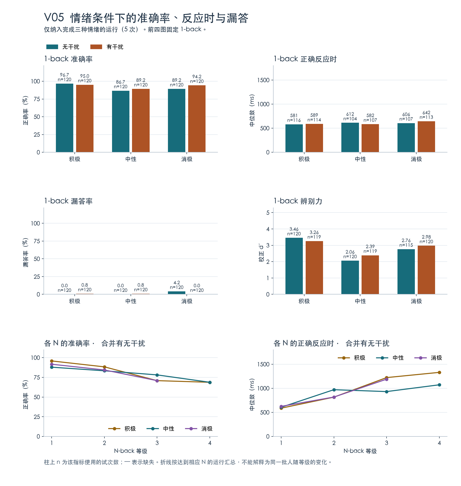

# V05 · 束搜索与配对词序 v0.1、85% 阶梯

[返回跨版本分析](README.md) · [对应代码](../../代码包/V05.zip) · [设计与版本](../../设计与版本.md) · [反馈与改进](../../反馈与改进.md)

**单次运行单独看：** [打开 V05 的逐次图表和数据](逐次分析/V05.md)。

## 情绪表现图

上四图固定 1-back，分情绪比较有无干扰。下两图按 N 合并有无干扰，较高 N 只汇总实际达到该等级的运行。正确反应时使用中位数，柱上 n 为该指标实际纳入的试次数。

## 运行记录与核对

运行清单共 5 份，完成 5、部分 0、无计分 0。逐试次复核 1920 个计分试次、80 个有区块汇总的区块、40 个有等级判定的有无干扰配对。另有 0 个已写试次但没有区块汇总的区块。

| 运行包 | 状态 | 情绪顺序（计划） | 正确／计分 | 漏答 | 正确 RT 中位数（ms） | 完成区块 | 试次历时和（分） | 最高 N（积极／中性／消极） |
| --- | --- | --- | --- | --- | --- | --- | --- | --- |
| [V05-R01](../V05-R01.zip) | 完成 | 消极→中性→积极 | 280/336（83.3%） | 0 | 624 | 14 | 7.40 | 2／0／2 |
| [V05-R02](../V05-R02.zip) | 完成 | 中性→积极→消极 | 324/384（84.4%） | 16 | 1026 | 16 | 12.15 | 2／1／2 |
| [V05-R03](../V05-R03.zip) | 完成 | 积极→中性→消极 | 357/432（82.6%） | 0 | 936 | 18 | 12.11 | 2／3／1 |
| [V05-R04](../V05-R04.zip) | 完成 | 消极→中性→积极 | 272/336（81.0%） | 9 | 1028 | 14 | 10.47 | 3／1／0 |
| [V05-R05](../V05-R05.zip) | 完成 | 消极→积极→中性 | 375/432（86.8%） | 0 | 472 | 18 | 8.62 | 2／2／2 |

试次历时和取日志字段 trial_elapsed_seconds 的加总，含启动词。它只反映记录下来的试次时间，不等于全程用时。最高 N 的 0 表示 1-back 未达升级线。

## 按 N 和试次类别

以下行为汇总只纳入完成三种情绪的运行。每一级或类别按试次汇总，运行贡献量可不同。

| 分组 | 正确／计分 | 漏答 | 正确 RT 中位数（ms） | 正确 RT 均值（ms） | 命中／目标作答 | 虚报／非目标作答 | 校正 d′ |
| --- | --- | --- | --- | --- | --- | --- | --- |
| 1-back | 661/720（91.8%） | 7 | 606 | 667 | 205/236（86.9%） | 21/477（4.4%） | 2.81 |
| 2-back | 534/624（85.6%） | 5 | 865 | 980 | 157/206（76.2%） | 36/413（8.7%） | 2.06 |
| 3-back | 347/480（72.3%） | 12 | 1141 | 1227 | 92/156（59.0%） | 57/312（18.3%） | 1.13 |
| 4-back | 66/96（68.8%） | 1 | 1140 | 1288 | 17/31（54.8%） | 15/64（23.4%） | 0.83 |

| 分组 | 正确／计分 | 漏答 | 正确 RT 中位数（ms） | 正确 RT 均值（ms） | 命中／目标作答 | 虚报／非目标作答 | 校正 d′ |
| --- | --- | --- | --- | --- | --- | --- | --- |
| 匹配 | 471/640（73.6%） | 11 | 772 | 907 | 471/629（74.9%） | — | — |
| 诱饵 | 530/640（82.8%） | 3 | 902 | 983 | — | 107/637（16.8%） | — |
| 其他非匹配·曾出现 | 255/280（91.1%） | 5 | 906 | 1025 | — | 20/275（7.3%） | — |
| 其他非匹配·首次出现 | 352/360（97.8%） | 6 | 673 | 754 | — | 2/354（0.6%） | — |

## 同一 N 的情绪位置和干扰比较

固定 1-back，并分开显示情绪与干扰条件。校正 d′ 只计有效 J/F 作答，漏答单列，正确率仍以所有计分试次为分母。

| 分组 | 正确／计分 | 漏答 | 正确 RT 中位数（ms） | 正确 RT 均值（ms） | 命中／目标作答 | 虚报／非目标作答 | 校正 d′ |
| --- | --- | --- | --- | --- | --- | --- | --- |
| 积极 · 无干扰 | 116/120（96.7%） | 0 | 581 | 637 | 37/40（92.5%） | 1/80（1.2%） | 3.46 |
| 积极 · 有干扰 | 114/120（95.0%） | 1 | 589 | 667 | 38/40（95.0%） | 3/79（3.8%） | 3.26 |
| 中性 · 无干扰 | 104/120（86.7%） | 0 | 612 | 654 | 30/40（75.0%） | 6/80（7.5%） | 2.06 |
| 中性 · 有干扰 | 107/120（89.2%） | 1 | 582 | 651 | 33/39（84.6%） | 6/80（7.5%） | 2.39 |
| 消极 · 无干扰 | 107/120（89.2%） | 5 | 606 | 687 | 32/37（86.5%） | 3/78（3.8%） | 2.76 |
| 消极 · 有干扰 | 113/120（94.2%） | 0 | 642 | 705 | 35/40（87.5%） | 2/80（2.5%） | 2.98 |

| 情绪组出现位置（仅 1-back） | 正确／计分 | 漏答 |
| --- | --- | --- |
| 1 | 219/240（91.2%） | 6 |
| 2 | 215/240（89.6%） | 0 |
| 3 | 227/240（94.6%） | 1 |

差值按同一运行、同一情绪、同一 N 的“有干扰减去无干扰”计算。全等级只用于描述各记录的配对方向，主要对照看各完成运行均具备的 1-back。

| 范围 | 配对数 | 有干扰较高／较低／持平 | 平均差（百分点） | 差中位数（百分点） |
| --- | --- | --- | --- | --- |
| 仅 1-back | 15 | 6／3／6 | 1.94 | 0.00 |
| 全部已完成配对 | 40 | 21／11／8 | 2.08 | 4.17 |

## 词序结构复算

| N | 区块数 | 平均实际词数 | 计分阶段首次出现词／区块 | 有连续六位置至多两种词的区块 | 观察到的最长正确 F 串 | 凭熟悉度的模拟正确题数／24 |
| --- | --- | --- | --- | --- | --- | --- |
| 1 | 30 | 8.0 | 7.0 | 29/30 | 4 | 15.0 |
| 2 | 26 | 5.0 | 3.0 | 0/26 | 5 | 11.0 |
| 3 | 20 | 6.0 | 3.0 | 0/20 | 4 | 11.0 |
| 4 | 4 | 7.0 | 3.0 | 0/4 | 4 | 11.0 |

结构表使用完成运行的区块，重复窗口包含启动词。模拟策略是“词在本区块出现过按 J，否则按 F”，用于衡量捷径本身可获得的分数。始终按 F 在这些区块固定能答对 16/24。两者都不是对单个被试策略的分类。

## 这版数据支持什么改动

- **词序改动实现了可验证的结构目标。** 80/80 个完成区块满足 8／8／8，2–4-back 的 50/50 个区块两方向诱饵各 4 个。完成运行的 2、3-back 首次出现词分别从 V04 的 6、5 个/区块变为 V05 的 3、3 个；2-back 的低多样性窗口由 V04 的 10/12 块变为 0/26，3-back 保持 0/20。现有作答最多到 4-back，5–6-back 的生成目标尚未由这些被试运行验证。
- **熟悉度捷径被限制，数据仍提示它可能有用。** 按“见过按 J，没见过按 F”在这些记录上模拟，2-back 从 V04 的 14/24 变为 V05 的 11/24，3-back 从 13/24 变为 11/24。始终按 F 的基准仍是 16/24。现实作答中，首次出现的普通非匹配正确 352/360，正确 RT 均值 754 ms；已出现的普通非匹配为 255/280、1025 ms。按相同 N 复看，2-back 的对应 RT 为 871 和 984 ms，3-back 为 986 和 1166 ms。1-back 仍有 7 个首次出现词，且该级熟悉的普通非匹配只有 30 次，不能用总 RT 或命中率证明策略彻底消失。
- **配对减轻结构混淆，干扰效应仍不统一。** 40 个配对均有相似度距离，范围 0.10–6.20，中位数 2.05（程序的加权距离单位）。1-back 的 15 个配对为有干扰较高 6、较低 3、持平 6。V04 的方向分布不同；缺少早期可直接比较的同尺度配对距离和独立验证，不能用这两个版本判断配对消除了难度差。
- **组织者的练习反馈促成热身。** 固定 1-back 时位置汇总为 219/240 → 215/240 → 227/240；五次中三次第三组优于第一组。方向在各人和情绪顺序间不一致。现有数据可支持把规则学习移到正式诱导前，但尚不能说独立热身已减少正式数据中的练习差异。
- **缺少旧诱导的主观评分。** 这版完整运行的行为数据仍无法确认图片与音频改变了情绪。组织者转述的“许多被试感觉不出诱导”直接指向下一版的设计，即更长、更连续的影片和片前片后效价／唤醒度评分。
