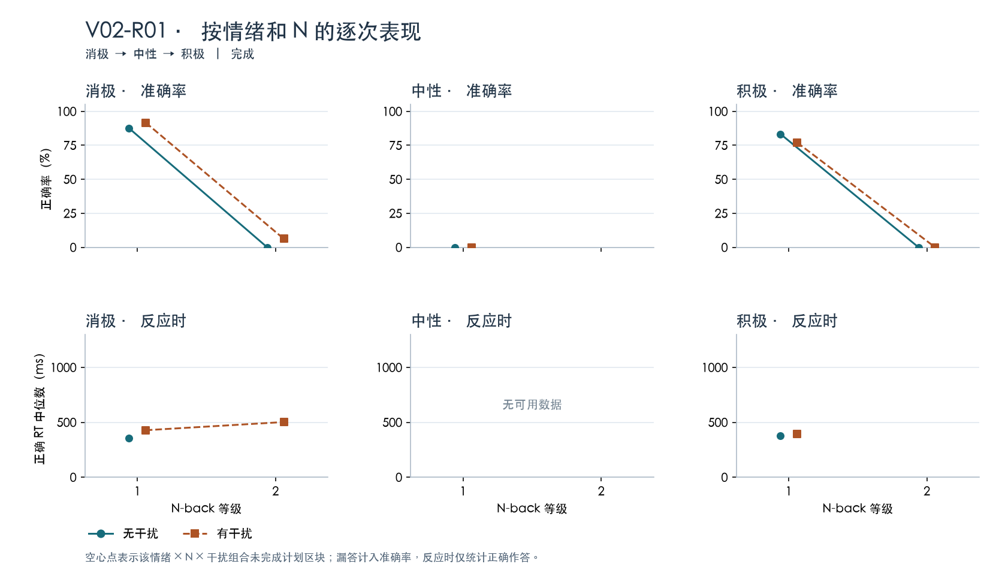
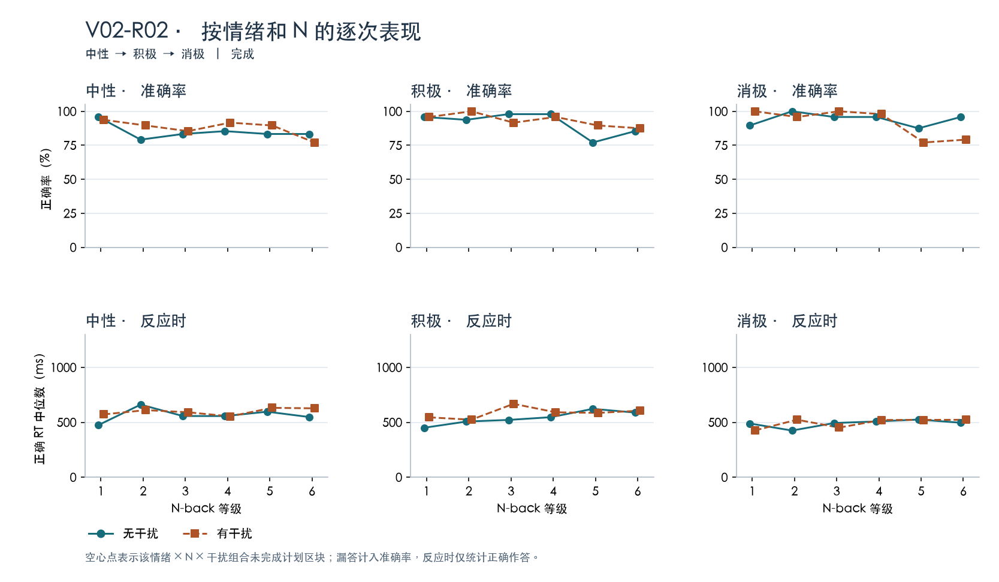
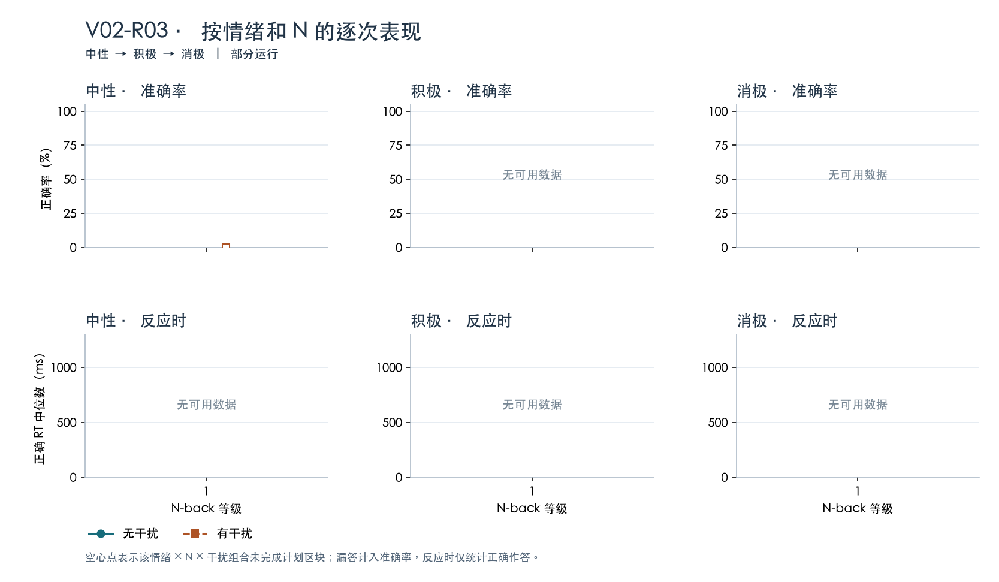
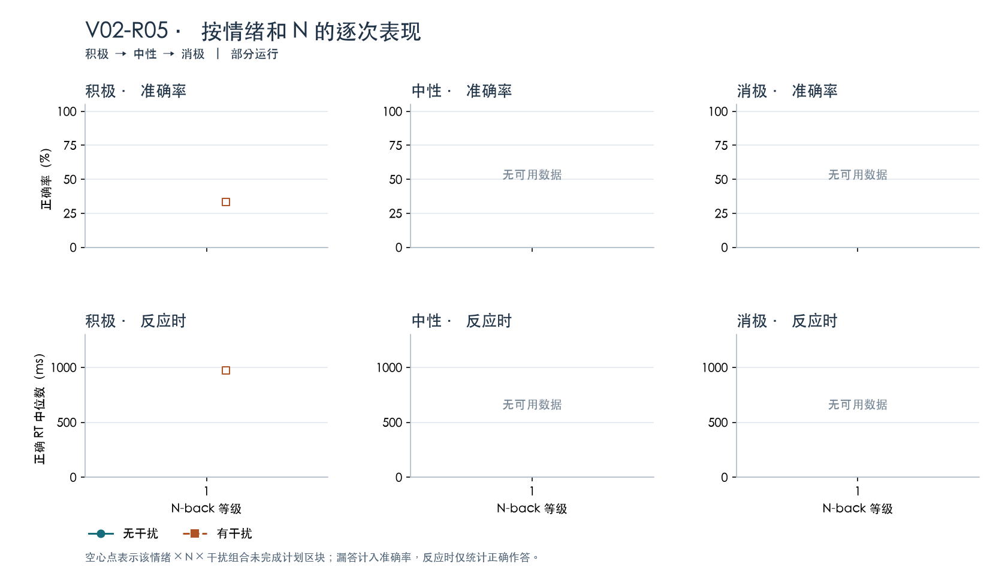

# V02 逐次运行分析

[返回版本汇总](../V02.md) · [逐次分析索引](README.md)

每个编号是一次去标识化运行。档案无法确认哪些编号属于同一人。漏答计入正确率分母，RT 中位数仅用正确且有记录的 J/F 作答，校正 d′ 按有效作答计算。有完整区块日志且达到计划区块数的条件才在图中连线。

[V02-R01](#v02-r01) · [V02-R02](#v02-r02) · [V02-R03](#v02-r03) · [V02-R04](#v02-r04) · [V02-R05](#v02-r05) · [V02-R06](#v02-r06)

### V02-R01

[原始数据 ZIP](../../V02-R01.zip) · 状态：完成 · 计划顺序：消极 → 中性 → 积极

整体正确 **166/480（34.6%）**，漏答 286，正确 RT 中位数 392 ms，最高通过 N（积极／中性／消极）为 1／0／1。

| 情绪 | N | 干扰 | 完成／计划区块 | 正确／计分 | 漏答 | 正确 RT 中位数（ms） | 命中／有效匹配 | 虚报／有效非匹配 | 校正 d′ |
| --- | --- | --- | --- | --- | --- | --- | --- | --- | --- |
| 消极 | 1 | 无干扰 | 2/2 | 42/48（87.5%） | 0 | 356 | 11/16（68.8%） | 1/32（3.1%） | 2.15 |
| 消极 | 1 | 有干扰 | 2/2 | 44/48（91.7%） | 0 | 428 | 12/16（75.0%） | 0/32（0.0%） | 2.80 |
| 消极 | 2 | 无干扰 | 2/2 | 0/48（0.0%） | 48 | — | — | — | — |
| 消极 | 2 | 有干扰 | 2/2 | 3/48（6.2%） | 45 | 502 | 1/1（100.0%） | 0/2（0.0%） | 1.64 |
| 中性 | 1 | 无干扰 | 2/2 | 0/48（0.0%） | 48 | — | — | — | — |
| 中性 | 1 | 有干扰 | 2/2 | 0/48（0.0%） | 48 | — | — | — | — |
| 积极 | 1 | 无干扰 | 2/2 | 40/48（83.3%） | 1 | 378 | 9/15（60.0%） | 1/32（3.1%） | 1.93 |
| 积极 | 1 | 有干扰 | 2/2 | 37/48（77.1%） | 0 | 394 | 7/16（43.8%） | 2/32（6.2%） | 1.29 |
| 积极 | 2 | 无干扰 | 2/2 | 0/48（0.0%） | 48 | — | — | — | — |
| 积极 | 2 | 有干扰 | 2/2 | 0/48（0.0%） | 48 | — | — | — | — |

漏答比例最高的组合是 **消极 · 2-back · 无干扰**（48/48（100.0%））。

**固定 1-back 的实际组序**：消极 86/96（89.6%） → 中性 0/96（0.0%） → 积极 77/96（80.2%）。

有干扰准确率较高／较低／持平为 **2／1／2**。下表均为同一情绪、同一 N 内的「有干扰减无干扰」。

| 情绪 | N | 准确率差（百分点） | 正确 RT 中位数差（ms） | 校正 d′ 差 | 漏答数差 |
| --- | --- | --- | --- | --- | --- |
| 消极 | 1 | +4.2 | +72 | +0.65 | 0 |
| 消极 | 2 | +6.2 | — | — | -3 |
| 中性 | 1 | +0.0 | — | — | 0 |
| 积极 | 1 | -6.2 | +17 | -0.64 | -1 |
| 积极 | 2 | +0.0 | — | — | 0 |

| 试次类型 | 正确／计分 | 正确 RT 中位数（ms） |
| --- | --- | --- |
| 匹配 | 40/160（25.0%） | 423 |
| 诱饵 | 15/49（30.6%） | 446 |
| 其他非匹配·熟悉度不详 | 111/271（41.0%） | 376 |

### V02-R02

[原始数据 ZIP](../../V02-R02.zip) · 状态：完成 · 计划顺序：中性 → 积极 → 消极

整体正确 **1565/1728（90.6%）**，漏答 4，正确 RT 中位数 542 ms，最高通过 N（积极／中性／消极）为 6／6／6。

| 情绪 | N | 干扰 | 完成／计划区块 | 正确／计分 | 漏答 | 正确 RT 中位数（ms） | 命中／有效匹配 | 虚报／有效非匹配 | 校正 d′ |
| --- | --- | --- | --- | --- | --- | --- | --- | --- | --- |
| 中性 | 1 | 无干扰 | 2/2 | 46/48（95.8%） | 0 | 475 | 15/16（93.8%） | 1/32（3.1%） | 3.04 |
| 中性 | 1 | 有干扰 | 2/2 | 45/48（93.8%） | 0 | 571 | 15/16（93.8%） | 2/32（6.2%） | 2.79 |
| 中性 | 2 | 无干扰 | 2/2 | 38/48（79.2%） | 1 | 661 | 10/16（62.5%） | 3/31（9.7%） | 1.53 |
| 中性 | 2 | 有干扰 | 2/2 | 43/48（89.6%） | 1 | 610 | 15/16（93.8%） | 3/31（9.7%） | 2.58 |
| 中性 | 3 | 无干扰 | 2/2 | 40/48（83.3%） | 0 | 557 | 10/16（62.5%） | 2/32（6.2%） | 1.73 |
| 中性 | 3 | 有干扰 | 2/2 | 41/48（85.4%） | 0 | 591 | 11/16（68.8%） | 2/32（6.2%） | 1.89 |
| 中性 | 4 | 无干扰 | 2/2 | 41/48（85.4%） | 0 | 556 | 12/16（75.0%） | 3/32（9.4%） | 1.88 |
| 中性 | 4 | 有干扰 | 2/2 | 44/48（91.7%） | 0 | 554 | 14/16（87.5%） | 2/32（6.2%） | 2.48 |
| 中性 | 5 | 无干扰 | 2/2 | 40/48（83.3%） | 0 | 596 | 12/16（75.0%） | 4/32（12.5%） | 1.73 |
| 中性 | 5 | 有干扰 | 2/2 | 43/48（89.6%） | 0 | 631 | 13/16（81.2%） | 2/32（6.2%） | 2.25 |
| 中性 | 6 | 无干扰 | 2/2 | 40/48（83.3%） | 1 | 548 | 10/16（62.5%） | 1/31（3.2%） | 1.98 |
| 中性 | 6 | 有干扰 | 2/2 | 37/48（77.1%） | 1 | 627 | 8/16（50.0%） | 2/31（6.5%） | 1.42 |
| 积极 | 1 | 无干扰 | 2/2 | 46/48（95.8%） | 0 | 450 | 14/16（87.5%） | 0/32（0.0%） | 3.22 |
| 积极 | 1 | 有干扰 | 2/2 | 46/48（95.8%） | 0 | 545 | 14/16（87.5%） | 0/32（0.0%） | 3.22 |
| 积极 | 2 | 无干扰 | 2/2 | 45/48（93.8%） | 0 | 506 | 15/16（93.8%） | 2/32（6.2%） | 2.79 |
| 积极 | 2 | 有干扰 | 2/2 | 48/48（100.0%） | 0 | 523 | 16/16（100.0%） | 0/32（0.0%） | 4.06 |
| 积极 | 3 | 无干扰 | 2/2 | 47/48（97.9%） | 0 | 521 | 16/16（100.0%） | 1/32（3.1%） | 3.58 |
| 积极 | 3 | 有干扰 | 2/2 | 44/48（91.7%） | 0 | 668 | 14/16（87.5%） | 2/32（6.2%） | 2.48 |
| 积极 | 4 | 无干扰 | 2/2 | 47/48（97.9%） | 0 | 546 | 16/16（100.0%） | 1/32（3.1%） | 3.58 |
| 积极 | 4 | 有干扰 | 2/2 | 46/48（95.8%） | 0 | 591 | 14/16（87.5%） | 0/32（0.0%） | 3.22 |
| 积极 | 5 | 无干扰 | 2/2 | 37/48（77.1%） | 0 | 622 | 12/16（75.0%） | 7/32（21.9%） | 1.38 |
| 积极 | 5 | 有干扰 | 2/2 | 43/48（89.6%） | 0 | 585 | 12/16（75.0%） | 1/32（3.1%） | 2.32 |
| 积极 | 6 | 无干扰 | 2/2 | 41/48（85.4%） | 0 | 588 | 12/16（75.0%） | 3/32（9.4%） | 1.88 |
| 积极 | 6 | 有干扰 | 2/2 | 42/48（87.5%） | 0 | 605 | 13/16（81.2%） | 3/32（9.4%） | 2.07 |
| 消极 | 1 | 无干扰 | 2/2 | 43/48（89.6%） | 0 | 489 | 12/16（75.0%） | 1/32（3.1%） | 2.32 |
| 消极 | 1 | 有干扰 | 2/2 | 48/48（100.0%） | 0 | 426 | 16/16（100.0%） | 0/32（0.0%） | 4.06 |
| 消极 | 2 | 无干扰 | 2/2 | 48/48（100.0%） | 0 | 425 | 16/16（100.0%） | 0/32（0.0%） | 4.06 |
| 消极 | 2 | 有干扰 | 2/2 | 46/48（95.8%） | 0 | 523 | 14/16（87.5%） | 0/32（0.0%） | 3.22 |
| 消极 | 3 | 无干扰 | 2/2 | 46/48（95.8%） | 0 | 493 | 16/16（100.0%） | 2/32（6.2%） | 3.32 |
| 消极 | 3 | 有干扰 | 2/2 | 48/48（100.0%） | 0 | 451 | 16/16（100.0%） | 0/32（0.0%） | 4.06 |
| 消极 | 4 | 无干扰 | 2/2 | 46/48（95.8%） | 0 | 507 | 14/16（87.5%） | 0/32（0.0%） | 3.22 |
| 消极 | 4 | 有干扰 | 2/2 | 47/48（97.9%） | 0 | 521 | 15/16（93.8%） | 0/32（0.0%） | 3.52 |
| 消极 | 5 | 无干扰 | 2/2 | 42/48（87.5%） | 0 | 525 | 13/16（81.2%） | 3/32（9.4%） | 2.07 |
| 消极 | 5 | 有干扰 | 2/2 | 37/48（77.1%） | 0 | 522 | 9/16（56.2%） | 4/32（12.5%） | 1.24 |
| 消极 | 6 | 无干扰 | 2/2 | 46/48（95.8%） | 0 | 496 | 14/16（87.5%） | 0/32（0.0%） | 3.22 |
| 消极 | 6 | 有干扰 | 2/2 | 38/48（79.2%） | 0 | 523 | 11/16（68.8%） | 5/32（15.6%） | 1.43 |

漏答比例最高的组合是 **中性 · 2-back · 无干扰**（1/48（2.1%））。

**固定 1-back 的实际组序**：中性 91/96（94.8%） → 积极 92/96（95.8%） → 消极 91/96（94.8%）。

有干扰准确率较高／较低／持平为 **10／7／1**。下表均为同一情绪、同一 N 内的「有干扰减无干扰」。

| 情绪 | N | 准确率差（百分点） | 正确 RT 中位数差（ms） | 校正 d′ 差 | 漏答数差 |
| --- | --- | --- | --- | --- | --- |
| 中性 | 1 | -2.1 | +97 | -0.26 | 0 |
| 中性 | 2 | +10.4 | -50 | +1.05 | 0 |
| 中性 | 3 | +2.1 | +34 | +0.16 | 0 |
| 中性 | 4 | +6.2 | -2 | +0.61 | 0 |
| 中性 | 5 | +6.2 | +35 | +0.53 | 0 |
| 中性 | 6 | -6.2 | +79 | -0.56 | 0 |
| 积极 | 1 | +0.0 | +95 | +0.00 | 0 |
| 积极 | 2 | +6.2 | +17 | +1.27 | 0 |
| 积极 | 3 | -6.2 | +146 | -1.10 | 0 |
| 积极 | 4 | -2.1 | +44 | -0.36 | 0 |
| 积极 | 5 | +12.5 | -37 | +0.94 | 0 |
| 积极 | 6 | +2.1 | +17 | +0.19 | 0 |
| 消极 | 1 | +10.4 | -63 | +1.74 | 0 |
| 消极 | 2 | -4.2 | +99 | -0.84 | 0 |
| 消极 | 3 | +4.2 | -42 | +0.73 | 0 |
| 消极 | 4 | +2.1 | +14 | +0.30 | 0 |
| 消极 | 5 | -10.4 | -3 | -0.82 | 0 |
| 消极 | 6 | -16.7 | +27 | -1.79 | 0 |

| 试次类型 | 正确／计分 | 正确 RT 中位数（ms） |
| --- | --- | --- |
| 匹配 | 479/576（83.2%） | 589 |
| 诱饵 | 179/230（77.8%） | 724 |
| 其他非匹配·熟悉度不详 | 907/922（98.4%） | 507 |

### V02-R03

[原始数据 ZIP](../../V02-R03.zip) · 状态：部分运行 · 计划顺序：中性 → 积极 → 消极

整体正确 **0/2（0.0%）**，漏答 2，正确 RT 中位数 — ms，最高通过 N（积极／中性／消极）为 —／—／—。

| 情绪 | N | 干扰 | 完成／计划区块 | 正确／计分 | 漏答 | 正确 RT 中位数（ms） | 命中／有效匹配 | 虚报／有效非匹配 | 校正 d′ |
| --- | --- | --- | --- | --- | --- | --- | --- | --- | --- |
| 中性 | 1 | 有干扰 | 0/2 | 0/2（0.0%） | 2 | — | — | — | — |

漏答比例最高的组合是 **中性 · 1-back · 有干扰**（2/2（100.0%））。

未达到可配对比较的等级。部分区块保留在上表。

| 试次类型 | 正确／计分 | 正确 RT 中位数（ms） |
| --- | --- | --- |
| 其他非匹配·熟悉度不详 | 0/2（0.0%） | — |

### V02-R04

[原始数据 ZIP](../../V02-R04.zip) · 状态：部分运行 · 计划顺序：积极 → 消极 → 中性

整体正确 **20/24（83.3%）**，漏答 0，正确 RT 中位数 374 ms，最高通过 N（积极／中性／消极）为 —／—／—。

| 情绪 | N | 干扰 | 完成／计划区块 | 正确／计分 | 漏答 | 正确 RT 中位数（ms） | 命中／有效匹配 | 虚报／有效非匹配 | 校正 d′ |
| --- | --- | --- | --- | --- | --- | --- | --- | --- | --- |
| 积极 | 1 | 无干扰 | 1/2 | 20/24（83.3%） | 0 | 374 | 6/8（75.0%） | 2/16（12.5%） | 1.64 |

未达到可配对比较的等级。部分区块保留在上表。

| 试次类型 | 正确／计分 | 正确 RT 中位数（ms） |
| --- | --- | --- |
| 匹配 | 6/8（75.0%） | 390 |
| 诱饵 | 4/5（80.0%） | 364 |
| 其他非匹配·熟悉度不详 | 10/11（90.9%） | 380 |

### V02-R05

[原始数据 ZIP](../../V02-R05.zip) · 状态：部分运行 · 计划顺序：积极 → 中性 → 消极

整体正确 **1/3（33.3%）**，漏答 2，正确 RT 中位数 972 ms，最高通过 N（积极／中性／消极）为 —／—／—。

| 情绪 | N | 干扰 | 完成／计划区块 | 正确／计分 | 漏答 | 正确 RT 中位数（ms） | 命中／有效匹配 | 虚报／有效非匹配 | 校正 d′ |
| --- | --- | --- | --- | --- | --- | --- | --- | --- | --- |
| 积极 | 1 | 有干扰 | 0/2 | 1/3（33.3%） | 2 | 972 | 1/1（100.0%） | — | — |

漏答比例最高的组合是 **积极 · 1-back · 有干扰**（2/3（66.7%））。

未达到可配对比较的等级。部分区块保留在上表。

| 试次类型 | 正确／计分 | 正确 RT 中位数（ms） |
| --- | --- | --- |
| 匹配 | 1/3（33.3%） | 972 |

### V02-R06

[原始数据 ZIP](../../V02-R06.zip) · 状态：部分运行 · 计划顺序：消极 → 积极 → 中性

整体正确 **41/48（85.4%）**，漏答 0，正确 RT 中位数 371 ms，最高通过 N（积极／中性／消极）为 —／—／—。

| 情绪 | N | 干扰 | 完成／计划区块 | 正确／计分 | 漏答 | 正确 RT 中位数（ms） | 命中／有效匹配 | 虚报／有效非匹配 | 校正 d′ |
| --- | --- | --- | --- | --- | --- | --- | --- | --- | --- |
| 消极 | 1 | 有干扰 | 2/2 | 41/48（85.4%） | 0 | 371 | 11/16（68.8%） | 2/32（6.2%） | 1.89 |

未达到可配对比较的等级。部分区块保留在上表。

| 试次类型 | 正确／计分 | 正确 RT 中位数（ms） |
| --- | --- | --- |
| 匹配 | 11/16（68.8%） | 430 |
| 诱饵 | 2/4（50.0%） | 345 |
| 其他非匹配·熟悉度不详 | 28/28（100.0%） | 352 |
