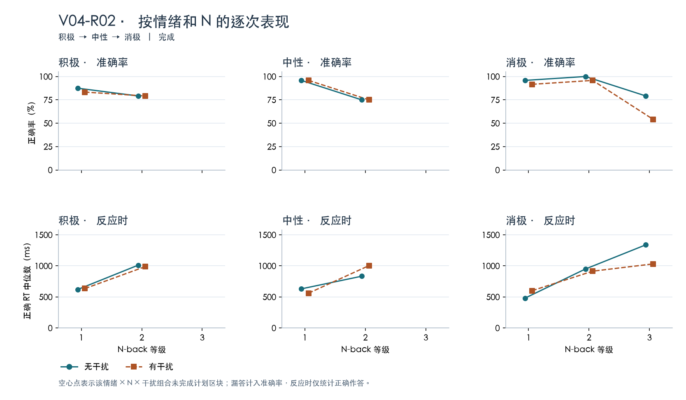
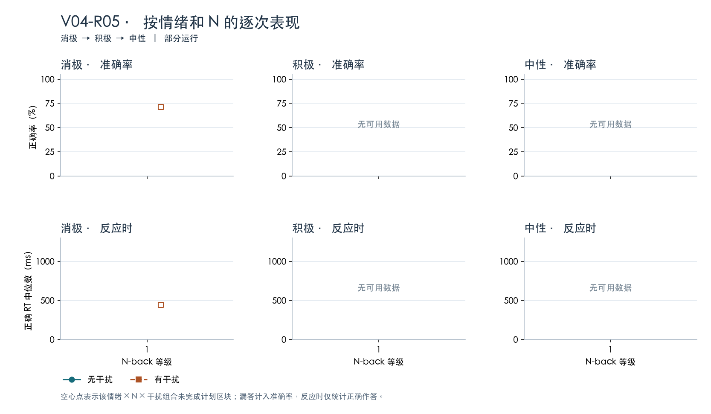
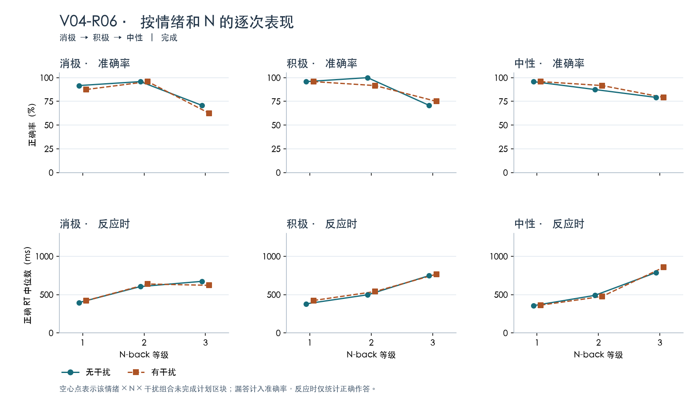

# V04 逐次运行分析

[返回版本汇总](../V04.md) · [逐次分析索引](README.md)

每个编号是一次去标识化运行。档案无法确认哪些编号属于同一人。漏答计入正确率分母，RT 中位数仅用正确且有记录的 J/F 作答，校正 d′ 按有效作答计算。有完整区块日志且达到计划区块数的条件才在图中连线。

[V04-R01](#v04-r01) · [V04-R02](#v04-r02) · [V04-R03](#v04-r03) · [V04-R04](#v04-r04) · [V04-R05](#v04-r05) · [V04-R06](#v04-r06)

### V04-R01

[原始数据 ZIP](../../V04-R01.zip) · 状态：部分运行 · 计划顺序：消极 → 中性 → 积极

整体正确 **60/68（88.2%）**，漏答 0，正确 RT 中位数 444 ms，最高通过 N（积极／中性／消极）为 —／—／—。

| 情绪 | N | 干扰 | 完成／计划区块 | 正确／计分 | 漏答 | 正确 RT 中位数（ms） | 命中／有效匹配 | 虚报／有效非匹配 | 校正 d′ |
| --- | --- | --- | --- | --- | --- | --- | --- | --- | --- |
| 消极 | 1 | 无干扰 | 1/1 | 22/24（91.7%） | 0 | 438 | 6/8（75.0%） | 0/16（0.0%） | 2.48 |
| 消极 | 1 | 有干扰 | 1/1 | 23/24（95.8%） | 0 | 403 | 8/8（100.0%） | 1/16（6.2%） | 2.94 |
| 消极 | 2 | 有干扰 | 0/1 | 15/20（75.0%） | 0 | 996 | 5/7（71.4%） | 3/13（23.1%） | 1.16 |

有干扰准确率较高／较低／持平为 **1／0／0**。下表均为同一情绪、同一 N 内的「有干扰减无干扰」。

| 情绪 | N | 准确率差（百分点） | 正确 RT 中位数差（ms） | 校正 d′ 差 | 漏答数差 |
| --- | --- | --- | --- | --- | --- |
| 消极 | 1 | +4.2 | -35 | +0.47 | 0 |

| 试次类型 | 正确／计分 | 正确 RT 中位数（ms） |
| --- | --- | --- |
| 匹配 | 19/23（82.6%） | 435 |
| 诱饵 | 20/23（87.0%） | 478 |
| 其他非匹配·曾出现 | 2/3（66.7%） | 356 |
| 其他非匹配·首次出现 | 19/19（100.0%） | 443 |

### V04-R02

[原始数据 ZIP](../../V04-R02.zip) · 状态：完成 · 计划顺序：积极 → 中性 → 消极

整体正确 **285/336（84.8%）**，漏答 0，正确 RT 中位数 795 ms，最高通过 N（积极／中性／消极）为 1／1／2。

| 情绪 | N | 干扰 | 完成／计划区块 | 正确／计分 | 漏答 | 正确 RT 中位数（ms） | 命中／有效匹配 | 虚报／有效非匹配 | 校正 d′ |
| --- | --- | --- | --- | --- | --- | --- | --- | --- | --- |
| 积极 | 1 | 无干扰 | 1/1 | 21/24（87.5%） | 0 | 620 | 6/8（75.0%） | 1/16（6.2%） | 1.94 |
| 积极 | 1 | 有干扰 | 1/1 | 20/24（83.3%） | 0 | 635 | 5/8（62.5%） | 1/16（6.2%） | 1.63 |
| 积极 | 2 | 无干扰 | 1/1 | 19/24（79.2%） | 0 | 1011 | 6/8（75.0%） | 3/16（18.8%） | 1.41 |
| 积极 | 2 | 有干扰 | 1/1 | 19/24（79.2%） | 0 | 989 | 6/8（75.0%） | 3/16（18.8%） | 1.41 |
| 中性 | 1 | 无干扰 | 1/1 | 23/24（95.8%） | 0 | 630 | 7/8（87.5%） | 0/16（0.0%） | 2.86 |
| 中性 | 1 | 有干扰 | 1/1 | 23/24（95.8%） | 0 | 561 | 7/8（87.5%） | 0/16（0.0%） | 2.86 |
| 中性 | 2 | 无干扰 | 1/1 | 18/24（75.0%） | 0 | 834 | 5/8（62.5%） | 3/16（18.8%） | 1.10 |
| 中性 | 2 | 有干扰 | 1/1 | 18/24（75.0%） | 0 | 1004 | 4/8（50.0%） | 2/16（12.5%） | 1.05 |
| 消极 | 1 | 无干扰 | 1/1 | 23/24（95.8%） | 0 | 480 | 7/8（87.5%） | 0/16（0.0%） | 2.86 |
| 消极 | 1 | 有干扰 | 1/1 | 22/24（91.7%） | 0 | 601 | 6/8（75.0%） | 0/16（0.0%） | 2.48 |
| 消极 | 2 | 无干扰 | 1/1 | 24/24（100.0%） | 0 | 950 | 8/8（100.0%） | 0/16（0.0%） | 3.48 |
| 消极 | 2 | 有干扰 | 1/1 | 23/24（95.8%） | 0 | 915 | 7/8（87.5%） | 0/16（0.0%） | 2.86 |
| 消极 | 3 | 无干扰 | 1/1 | 19/24（79.2%） | 0 | 1340 | 5/8（62.5%） | 2/16（12.5%） | 1.33 |
| 消极 | 3 | 有干扰 | 1/1 | 13/24（54.2%） | 0 | 1032 | 3/8（37.5%） | 6/16（37.5%） | 0.02 |

**固定 1-back 的实际组序**：积极 41/48（85.4%） → 中性 46/48（95.8%） → 消极 45/48（93.8%）。

有干扰准确率较高／较低／持平为 **0／4／3**。下表均为同一情绪、同一 N 内的「有干扰减无干扰」。

| 情绪 | N | 准确率差（百分点） | 正确 RT 中位数差（ms） | 校正 d′ 差 | 漏答数差 |
| --- | --- | --- | --- | --- | --- |
| 积极 | 1 | -4.2 | +15 | -0.31 | 0 |
| 积极 | 2 | +0.0 | -22 | +0.00 | 0 |
| 中性 | 1 | +0.0 | -69 | +0.00 | 0 |
| 中性 | 2 | +0.0 | +171 | -0.05 | 0 |
| 消极 | 1 | -4.2 | +121 | -0.38 | 0 |
| 消极 | 2 | -4.2 | -35 | -0.63 | 0 |
| 消极 | 3 | -25.0 | -308 | -1.31 | 0 |

| 试次类型 | 正确／计分 | 正确 RT 中位数（ms） |
| --- | --- | --- |
| 匹配 | 82/112（73.2%） | 824 |
| 诱饵 | 93/112（83.0%） | 843 |
| 其他非匹配·曾出现 | 23/24（95.8%） | 824 |
| 其他非匹配·首次出现 | 87/88（98.9%） | 738 |

### V04-R03

[原始数据 ZIP](../../V04-R03.zip) · 状态：部分运行 · 计划顺序：中性 → 消极 → 积极

整体正确 **27/48（56.2%）**，漏答 9，正确 RT 中位数 674 ms，最高通过 N（积极／中性／消极）为 —／0／—。

| 情绪 | N | 干扰 | 完成／计划区块 | 正确／计分 | 漏答 | 正确 RT 中位数（ms） | 命中／有效匹配 | 虚报／有效非匹配 | 校正 d′ |
| --- | --- | --- | --- | --- | --- | --- | --- | --- | --- |
| 中性 | 1 | 无干扰 | 1/1 | 15/24（62.5%） | 7 | 839 | 5/6（83.3%） | 1/11（9.1%） | 1.94 |
| 中性 | 1 | 有干扰 | 1/1 | 12/24（50.0%） | 2 | 164 | 5/8（62.5%） | 7/14（50.0%） | 0.28 |

漏答比例最高的组合是 **中性 · 1-back · 无干扰**（7/24（29.2%））。

有干扰准确率较高／较低／持平为 **0／1／0**。下表均为同一情绪、同一 N 内的「有干扰减无干扰」。

| 情绪 | N | 准确率差（百分点） | 正确 RT 中位数差（ms） | 校正 d′ 差 | 漏答数差 |
| --- | --- | --- | --- | --- | --- |
| 中性 | 1 | -12.5 | -675 | -1.66 | -5 |

| 试次类型 | 正确／计分 | 正确 RT 中位数（ms） |
| --- | --- | --- |
| 匹配 | 10/16（62.5%） | 608 |
| 诱饵 | 9/16（56.2%） | 956 |
| 其他非匹配·曾出现 | 1/2（50.0%） | 674 |
| 其他非匹配·首次出现 | 7/14（50.0%） | 619 |

### V04-R04

[原始数据 ZIP](../../V04-R04.zip) · 状态：没有计分试次 · 计划顺序：积极 → 消极 → 中性

没有计分试次，无法估计准确率或反应时。

### V04-R05

[原始数据 ZIP](../../V04-R05.zip) · 状态：部分运行 · 计划顺序：消极 → 积极 → 中性

整体正确 **5/7（71.4%）**，漏答 0，正确 RT 中位数 444 ms，最高通过 N（积极／中性／消极）为 —／—／—。

| 情绪 | N | 干扰 | 完成／计划区块 | 正确／计分 | 漏答 | 正确 RT 中位数（ms） | 命中／有效匹配 | 虚报／有效非匹配 | 校正 d′ |
| --- | --- | --- | --- | --- | --- | --- | --- | --- | --- |
| 消极 | 1 | 有干扰 | 0/1 | 5/7（71.4%） | 0 | 444 | 1/2（50.0%） | 1/5（20.0%） | 0.67 |

未达到可配对比较的等级。部分区块保留在上表。

| 试次类型 | 正确／计分 | 正确 RT 中位数（ms） |
| --- | --- | --- |
| 匹配 | 1/2（50.0%） | 444 |
| 诱饵 | 2/3（66.7%） | 507 |
| 其他非匹配·首次出现 | 2/2（100.0%） | 444 |

### V04-R06

[原始数据 ZIP](../../V04-R06.zip) · 状态：完成 · 计划顺序：消极 → 积极 → 中性

整体正确 **375/432（86.8%）**，漏答 0，正确 RT 中位数 520 ms，最高通过 N（积极／中性／消极）为 2／2／2。

| 情绪 | N | 干扰 | 完成／计划区块 | 正确／计分 | 漏答 | 正确 RT 中位数（ms） | 命中／有效匹配 | 虚报／有效非匹配 | 校正 d′ |
| --- | --- | --- | --- | --- | --- | --- | --- | --- | --- |
| 消极 | 1 | 无干扰 | 1/1 | 22/24（91.7%） | 0 | 396 | 7/8（87.5%） | 1/16（6.2%） | 2.32 |
| 消极 | 1 | 有干扰 | 1/1 | 21/24（87.5%） | 0 | 422 | 6/8（75.0%） | 1/16（6.2%） | 1.94 |
| 消极 | 2 | 无干扰 | 1/1 | 23/24（95.8%） | 0 | 604 | 7/8（87.5%） | 0/16（0.0%） | 2.86 |
| 消极 | 2 | 有干扰 | 1/1 | 23/24（95.8%） | 0 | 638 | 8/8（100.0%） | 1/16（6.2%） | 2.94 |
| 消极 | 3 | 无干扰 | 1/1 | 17/24（70.8%） | 0 | 672 | 2/8（25.0%） | 1/16（6.2%） | 0.76 |
| 消极 | 3 | 有干扰 | 1/1 | 15/24（62.5%） | 0 | 621 | 1/8（12.5%） | 2/16（12.5%） | 0.08 |
| 积极 | 1 | 无干扰 | 1/1 | 23/24（95.8%） | 0 | 380 | 7/8（87.5%） | 0/16（0.0%） | 2.86 |
| 积极 | 1 | 有干扰 | 1/1 | 23/24（95.8%） | 0 | 423 | 7/8（87.5%） | 0/16（0.0%） | 2.86 |
| 积极 | 2 | 无干扰 | 1/1 | 24/24（100.0%） | 0 | 497 | 8/8（100.0%） | 0/16（0.0%） | 3.48 |
| 积极 | 2 | 有干扰 | 1/1 | 22/24（91.7%） | 0 | 539 | 7/8（87.5%） | 1/16（6.2%） | 2.32 |
| 积极 | 3 | 无干扰 | 1/1 | 17/24（70.8%） | 0 | 747 | 6/8（75.0%） | 5/16（31.2%） | 1.05 |
| 积极 | 3 | 有干扰 | 1/1 | 18/24（75.0%） | 0 | 766 | 4/8（50.0%） | 2/16（12.5%） | 1.05 |
| 中性 | 1 | 无干扰 | 1/1 | 23/24（95.8%） | 0 | 355 | 7/8（87.5%） | 0/16（0.0%） | 2.86 |
| 中性 | 1 | 有干扰 | 1/1 | 23/24（95.8%） | 0 | 362 | 7/8（87.5%） | 0/16（0.0%） | 2.86 |
| 中性 | 2 | 无干扰 | 1/1 | 21/24（87.5%） | 0 | 489 | 7/8（87.5%） | 2/16（12.5%） | 2.02 |
| 中性 | 2 | 有干扰 | 1/1 | 22/24（91.7%） | 0 | 476 | 6/8（75.0%） | 0/16（0.0%） | 2.48 |
| 中性 | 3 | 无干扰 | 1/1 | 19/24（79.2%） | 0 | 789 | 7/8（87.5%） | 4/16（25.0%） | 1.60 |
| 中性 | 3 | 有干扰 | 1/1 | 19/24（79.2%） | 0 | 856 | 5/8（62.5%） | 2/16（12.5%） | 1.33 |

**固定 1-back 的实际组序**：消极 43/48（89.6%） → 积极 46/48（95.8%） → 中性 46/48（95.8%）。

有干扰准确率较高／较低／持平为 **2／3／4**。下表均为同一情绪、同一 N 内的「有干扰减无干扰」。

| 情绪 | N | 准确率差（百分点） | 正确 RT 中位数差（ms） | 校正 d′ 差 | 漏答数差 |
| --- | --- | --- | --- | --- | --- |
| 消极 | 1 | -4.2 | +26 | -0.38 | 0 |
| 消极 | 2 | +0.0 | +34 | +0.09 | 0 |
| 消极 | 3 | -8.3 | -52 | -0.68 | 0 |
| 积极 | 1 | +0.0 | +43 | +0.00 | 0 |
| 积极 | 2 | -8.3 | +42 | -1.16 | 0 |
| 积极 | 3 | +4.2 | +19 | +0.00 | 0 |
| 中性 | 1 | +0.0 | +7 | +0.00 | 0 |
| 中性 | 2 | +4.2 | -14 | +0.46 | 0 |
| 中性 | 3 | +0.0 | +67 | -0.26 | 0 |

| 试次类型 | 正确／计分 | 正确 RT 中位数（ms） |
| --- | --- | --- |
| 匹配 | 109/144（75.7%） | 489 |
| 诱饵 | 125/144（86.8%） | 527 |
| 其他非匹配·曾出现 | 33/36（91.7%） | 570 |
| 其他非匹配·首次出现 | 108/108（100.0%） | 508 |
