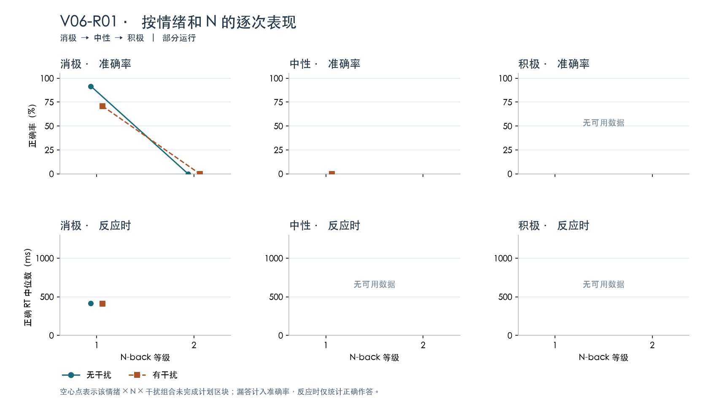
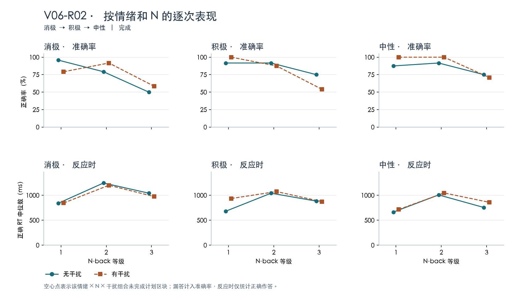

# V06 逐次运行分析

[返回版本汇总](../V06.md) · [逐次分析索引](README.md)

每个编号是一次去标识化运行。档案无法确认哪些编号属于同一人。漏答计入正确率分母，RT 中位数仅用正确且有记录的 J/F 作答，校正 d′ 按有效作答计算。有完整区块日志且达到计划区块数的条件才在图中连线。

[V06-R01](#v06-r01) · [V06-R02](#v06-r02)

### V06-R01

[原始数据 ZIP](../../V06-R01.zip) · 状态：部分运行 · 计划顺序：消极 → 中性 → 积极

整体正确 **39/120（32.5%）**，漏答 72，正确 RT 中位数 410 ms，最高通过 N（积极／中性／消极）为 —／—／1。

| 情绪 | N | 干扰 | 完成／计划区块 | 正确／计分 | 漏答 | 正确 RT 中位数（ms） | 命中／有效匹配 | 虚报／有效非匹配 | 校正 d′ |
| --- | --- | --- | --- | --- | --- | --- | --- | --- | --- |
| 消极 | 1 | 无干扰 | 1/1 | 22/24（91.7%） | 0 | 415 | 6/8（75.0%） | 0/16（0.0%） | 2.48 |
| 消极 | 1 | 有干扰 | 1/1 | 17/24（70.8%） | 0 | 410 | 3/8（37.5%） | 2/16（12.5%） | 0.77 |
| 消极 | 2 | 无干扰 | 1/1 | 0/24（0.0%） | 24 | — | — | — | — |
| 消极 | 2 | 有干扰 | 1/1 | 0/24（0.0%） | 24 | — | — | — | — |
| 中性 | 1 | 有干扰 | 1/1 | 0/24（0.0%） | 24 | — | — | — | — |

漏答比例最高的组合是 **消极 · 2-back · 无干扰**（24/24（100.0%））。

有干扰准确率较高／较低／持平为 **0／1／1**。下表均为同一情绪、同一 N 内的「有干扰减无干扰」。

| 情绪 | N | 准确率差（百分点） | 正确 RT 中位数差（ms） | 校正 d′ 差 | 漏答数差 |
| --- | --- | --- | --- | --- | --- |
| 消极 | 1 | -20.8 | -5 | -1.71 | 0 |
| 消极 | 2 | +0.0 | — | — | 0 |

| 试次类型 | 正确／计分 | 正确 RT 中位数（ms） |
| --- | --- | --- |
| 匹配 | 9/40（22.5%） | 458 |
| 诱饵 | 15/40（37.5%） | 423 |
| 其他非匹配·曾出现 | 2/13（15.4%） | 182 |
| 其他非匹配·首次出现 | 13/27（48.1%） | 393 |

| 影片条件 | 效价前→后 | 唤醒度前→后 |
| --- | --- | --- |
| 消极 | 7→3 | 6→7 |
| 中性 | 3→5 | 3→5 |

### V06-R02

[原始数据 ZIP](../../V06-R02.zip) · 状态：完成 · 计划顺序：消极 → 积极 → 中性

整体正确 **355/432（82.2%）**，漏答 1，正确 RT 中位数 935 ms，最高通过 N（积极／中性／消极）为 2／2／2。

| 情绪 | N | 干扰 | 完成／计划区块 | 正确／计分 | 漏答 | 正确 RT 中位数（ms） | 命中／有效匹配 | 虚报／有效非匹配 | 校正 d′ |
| --- | --- | --- | --- | --- | --- | --- | --- | --- | --- |
| 消极 | 1 | 无干扰 | 1/1 | 23/24（95.8%） | 0 | 839 | 8/8（100.0%） | 1/16（6.2%） | 2.94 |
| 消极 | 1 | 有干扰 | 1/1 | 19/24（79.2%） | 0 | 845 | 7/8（87.5%） | 4/16（25.0%） | 1.60 |
| 消极 | 2 | 无干扰 | 1/1 | 19/24（79.2%） | 0 | 1246 | 6/8（75.0%） | 3/16（18.8%） | 1.41 |
| 消极 | 2 | 有干扰 | 1/1 | 22/24（91.7%） | 1 | 1201 | 8/8（100.0%） | 1/15（6.7%） | 2.91 |
| 消极 | 3 | 无干扰 | 1/1 | 12/24（50.0%） | 0 | 1042 | 1/8（12.5%） | 5/16（31.2%） | -0.51 |
| 消极 | 3 | 有干扰 | 1/1 | 14/24（58.3%） | 0 | 973 | 3/8（37.5%） | 5/16（31.2%） | 0.18 |
| 积极 | 1 | 无干扰 | 1/1 | 22/24（91.7%） | 0 | 680 | 7/8（87.5%） | 1/16（6.2%） | 2.32 |
| 积极 | 1 | 有干扰 | 1/1 | 24/24（100.0%） | 0 | 935 | 8/8（100.0%） | 0/16（0.0%） | 3.48 |
| 积极 | 2 | 无干扰 | 1/1 | 22/24（91.7%） | 0 | 1042 | 6/8（75.0%） | 0/16（0.0%） | 2.48 |
| 积极 | 2 | 有干扰 | 1/1 | 21/24（87.5%） | 0 | 1074 | 7/8（87.5%） | 2/16（12.5%） | 2.02 |
| 积极 | 3 | 无干扰 | 1/1 | 18/24（75.0%） | 0 | 883 | 5/8（62.5%） | 3/16（18.8%） | 1.10 |
| 积极 | 3 | 有干扰 | 1/1 | 13/24（54.2%） | 0 | 873 | 5/8（62.5%） | 8/16（50.0%） | 0.28 |
| 中性 | 1 | 无干扰 | 1/1 | 21/24（87.5%） | 0 | 662 | 7/8（87.5%） | 2/16（12.5%） | 2.02 |
| 中性 | 1 | 有干扰 | 1/1 | 24/24（100.0%） | 0 | 715 | 8/8（100.0%） | 0/16（0.0%） | 3.48 |
| 中性 | 2 | 无干扰 | 1/1 | 22/24（91.7%） | 0 | 1007 | 7/8（87.5%） | 1/16（6.2%） | 2.32 |
| 中性 | 2 | 有干扰 | 1/1 | 24/24（100.0%） | 0 | 1047 | 8/8（100.0%） | 0/16（0.0%） | 3.48 |
| 中性 | 3 | 无干扰 | 1/1 | 18/24（75.0%） | 0 | 755 | 6/8（75.0%） | 4/16（25.0%） | 1.22 |
| 中性 | 3 | 有干扰 | 1/1 | 17/24（70.8%） | 0 | 859 | 4/8（50.0%） | 3/16（18.8%） | 0.82 |

漏答比例最高的组合是 **消极 · 2-back · 有干扰**（1/24（4.2%））。

**固定 1-back 的实际组序**：消极 42/48（87.5%） → 积极 46/48（95.8%） → 中性 45/48（93.8%）。

有干扰准确率较高／较低／持平为 **5／4／0**。下表均为同一情绪、同一 N 内的「有干扰减无干扰」。

| 情绪 | N | 准确率差（百分点） | 正确 RT 中位数差（ms） | 校正 d′ 差 | 漏答数差 |
| --- | --- | --- | --- | --- | --- |
| 消极 | 1 | -16.7 | +6 | -1.35 | 0 |
| 消极 | 2 | +12.5 | -46 | +1.50 | 1 |
| 消极 | 3 | +8.3 | -69 | +0.69 | 0 |
| 积极 | 1 | +8.3 | +255 | +1.16 | 0 |
| 积极 | 2 | -4.2 | +33 | -0.46 | 0 |
| 积极 | 3 | -20.8 | -10 | -0.82 | 0 |
| 中性 | 1 | +12.5 | +53 | +1.47 | 0 |
| 中性 | 2 | +8.3 | +40 | +1.16 | 0 |
| 中性 | 3 | -4.2 | +104 | -0.40 | 0 |

| 试次类型 | 正确／计分 | 正确 RT 中位数（ms） |
| --- | --- | --- |
| 匹配 | 111/144（77.1%） | 908 |
| 诱饵 | 116/144（80.6%） | 1034 |
| 其他非匹配·曾出现 | 51/66（77.3%） | 924 |
| 其他非匹配·首次出现 | 77/78（98.7%） | 822 |

| 影片条件 | 效价前→后 | 唤醒度前→后 |
| --- | --- | --- |
| 消极 | 5→5 | 1→3 |
| 积极 | 6→5 | 4→5 |
| 中性 | 7→5 | 6→5 |

### V06-FAIL-01

[故障摘要 ZIP](../../V06-FAIL-01.zip)。影片结束时退出，无计分试次。
